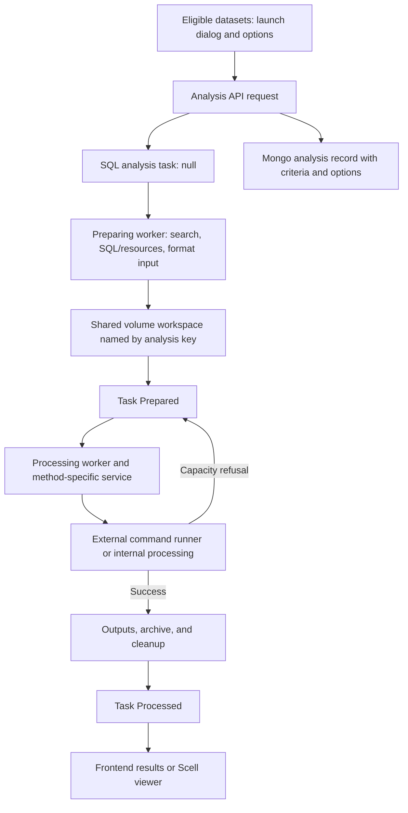

# Analysis preparation, execution, and results

Last updated: 2026-10-12.

The owner explained the analysis workflow, runner services, file-contract
conventions, and Scell viewer during onboarding. Selected local code confirms
the main stages. Individual scientific methods and deployment procedures are
not fully reviewed here.

## Starting an analysis

The frontend uses dataset summaries and method-specific requirements to decide
which analysis buttons to show. For example, a ten-donor cohort without gene
expression data cannot launch an analysis requiring gene expression. Detailed
eligibility rules differ by method.

The launch dialog has a shared name/description section and method-specific
options. The request includes the criteria for every selected dataset and the
analysis options. These are downstream dataset analyses, distinct from the
sample's current `Analysis`/Primary Assay domain concept.

`unite-analysis` creates a SQL task and a Mongo analysis record:

- SQL: the shared task entity has non-null `AnalysisTypeId`, whose enum is
  `AnalysisTaskType`. The task carries status, date, `Target`, and serialized
  analysis data used by workers.
- Mongo: `user-data.analyses` stores `Id`, `UserId`, `Name`, `Description`,
  `Date`, `Status`, `Comment`, `Type`, and `Data` (serialized dataset criteria
  and options).
- The returned analysis key is the Mongo record ID; it is assigned to the
  payload's `Id` and SQL task's `Target`. It differs from the SQL task's numeric
  `Id` and names the shared working directory.

Unlike successfully handled indexing tasks, completed analysis tasks are
retained by the reviewed processing service. The owner confirmed that analyses
and their remaining files/results are kept until deletion; there is no separate
automatic analysis expiry. Account deletion, including inactivity cleanup, also
removes saved analysis records/tasks; complete file cleanup for those paths
requires verification. See [Identity and lifecycle](identity-and-lifecycle.md).
Method-specific temporary-input cleanup and idle viewer removal are separate.

## Prepare and Process

`Unite.Analysis/Services` contains method-specific services derived from
`AnalysisService<TModel>`. Preparing and processing workers select the service
using the task's analysis type.

| Task status | Analysis meaning in the reviewed handlers |
| --- | --- |
| `null` | Created and queued for preparation |
| `Preparing` | Resolving datasets and preparing input data |
| `Prepared` | Input preparation complete; eligible for processing |
| `Processing` | Running the processing phase |
| `Processed` | Processing completed successfully |
| `Failed` | Preparation/processing failure; distinct from runner capacity refusal |

### Prepare

1. Evaluate dataset criteria through the search engine and establish the
   matching scope. Preserve the user's visibility constraints described in
   [Search and access](search-and-access.md).
2. Resolve relevant samples for the method. Selected context loaders obtain
   matching domain IDs through search, then follow SQL relationships to samples.
3. Load required integrated values and metadata from SQL. For loose resources,
   download the required source files, such as single-cell sample resources.
4. Format data for the method and write it into the shared Docker volume under
   the analysis key.
5. Return success so the task moves to `Prepared`.

Concrete selection and input materialization happen during preparation, after
the criteria-based request was created. Prepared files supply the processing
input. Do not assume that saving a dataset freezes its members, that submission
captures a SQL snapshot, or that all methods choose the same samples.

The owner's architectural requirement is that analysis selection respects
search visibility. Since 2026-10-07 dataset selection uses the creating
user's personal criteria; see
[Search and access](search-and-access.md#personal-criteria-and-project-visibility).

### Process

For methods using an external runner:

1. Call its web command wrapper with the analysis key.
2. The runner opens prepared files from the shared volume, performs the R/Python
   computation, and writes outputs into that analysis workspace.
3. On success, `unite-analysis` performs method-specific output processing,
   archiving, and cleanup and returns success; the task becomes `Processed`.

The request passes a key identifying files already shared with the container,
not the complete input dataset over HTTP. Processing language and container
contents depend on the method.

Not every local implementation calls an external runner: the reviewed GAF and
CNV profile services generate data internally during preparation, then package
results in `Process`. Preserve the two-phase interface without assuming both
phases always perform the same kinds of work.

This shows the successful path and capacity retry. Errors and restarts have
separate handling below.

## Runner capacity, errors, and retries

`unite-commands` wraps a **configured command** in a web API. Configuration
provides the command, arguments, source/data paths, and process limit; `{proc}`
is replaced with the request key. The current limit option is
`UNITE_PROCESS_LIMIT`.

When the runner is at its limit, `POST /api/run?key=...` returns HTTP `501`.
The base analysis client maps this to `AnalysisTaskStatus.Rejected`, an internal
phase result. `AnalysisTaskService.Iterate` restores the phase's start status;
for processing, this is `Prepared`, so the task can be attempted again.
The durable waiting task lives in `unite-analysis`; the busy command wrapper
does not accept and queue that command itself.

This capacity result is different from administrator rejection of a submission
and does not persist `TaskStatusType.Rejected` on the analysis task. HTTP `500`
or handler exceptions take the reviewed failure route to `Failed`. Startup
handlers mark interrupted `Preparing`/`Processing` tasks as `Failed` with a
service-reboot comment. The owner confirmed that preparation/computation
failures require **manual restart** by the user; they are not automatically
retried like busy-runner refusals. The API includes a restart path for ended
tasks. Do not carry the submission pipeline's automatic internal-error retry
policy into analyses.

The preparing and processing handlers each cap one `Iterate` call at ten
in-flight jobs (2-second interval). The counter is local to the call and resets
whenever the queue empties, so it is not a hard global limit. A refused task is
picked up again immediately, without backoff. Individual runner capacity is a
separate limit; if `UNITE_PROCESS_LIMIT` is unset, a runner never refuses.

The base capacity-retry protocol is verified, but **Scell does not retry**: its
`Process` deletes the downloaded sample directories and attempts archiving
regardless of the remote result. On a busy-runner refusal the inputs are
deleted, archiving throws because `result.data.h5ad` is missing, and the task
becomes `Failed`. DM and PCAM guard their postprocessing on success. This
contradicts the rule that a busy runner means "try again later" (see below)
and is tracked in Jira.

Phase result messages (the runner response body, CEDP validation warnings) are
returned in `AnalysisTaskResult.Message` but not written to the task; the only
persisted comment is the service-reboot one. The status endpoint returns
`{Status, Comment}` and copies both to the Mongo record. unite-commands returns
an empty body on failure (exit code > 0 → HTTP 500). Other status codes than
200/500/501 throw and lead to `Failed`. The runner HTTP timeout is 60 minutes.
The owner wants the failure reason written to the task comment, so users see
why an analysis failed (2026-10-09; tracked in Jira).

## Intended structure for analyses

`unite-analysis` is the least uniform repository: every method is different,
and a common template has not been settled yet, so methods were written with
different approaches. The most recent ones (e.g. CEDP) are the best reference,
but not final.

**Goal: one template and a ready API for analysis creators** (owner,
2026-10-09). Every analysis should follow the same rules and the same folder
structure. An analysis creator, for example a bioinformatician writing a new
method, should get a ready API that delivers the inputs they ask for ("I need
gene expressions and sample metadata", "I need methylation array samples and
donor metadata") in a known layout, together with simple rules: put results
here, put visualizations here. Following them integrates the analysis into
UNITE: not as deeply as the built-in methods, but usable end to end. The same
API also makes it faster for the UNITE team to add new analyses. The steps
below are the current draft of that template.

The owner's intended flow (2026-10-09), to follow for new methods and when
reworking old ones:

1. Prepare the metadata of the selected samples (e.g. `samples.tsv`).
2. Prepare the data, and metadata if needed, for these samples (`data.tsv` or
   `data.json`, `metadata.tsv` or `metadata.json`).
3. Prepare annotations if needed (e.g. `genes.tsv`, `proteins.tsv`).
4. Download resources if needed, into a `samples` subfolder.
5. Write `options.json`.
6. Put all inputs into the `input` subdirectory of the analysis (easier to
   organize than the root).
7. Trigger processing.
8. Processing writes all results into the `output` directory.
9. Run postprocessing if needed.
10. Remove downloaded sample resources (e.g. single-cell data) to save space.
11. Archive.

Rules that hold regardless of the method:

- **A busy runner means "try again later"**: the task waits for some time
  before the next attempt. Prepared inputs are not removed and nothing is
  archived until processing, and postprocessing if any, succeeded.
- **Sample identifiers: naming not settled** (owner, 2026-10-09). Sample
  metadata must carry three identifiers for every sample (donor, image or
  specimen):
  1. **Sample key**: human-readable and unique within the analysis, combined
     from the donor's reference ID, the image or specimen type and the image or
     specimen reference ID. Reference IDs are how users identify samples, but
     they are only unique per donor and type: different donors can have images
     with the same ID, and one donor can have an MR and a CT image, or specimens
     of different types, with the same ID.
  2. **Internal ID**: the database ID of the donor, image or specimen.
  3. **Original reference ID**: the reference ID the key is built from.

  Current code names them inconsistently: the readable key is written as
  `sample_id` (e.g. `D001-mat-S001`), the internal ID as `sample_key` (only for
  UMAPP and CEDP), and the reference IDs as `donor_id`, `specimen_id`,
  `image_id`. Settle the names in the analysis template and use them in all
  methods.
- **Archiving is not settled.** Ideally the downloadable archive is
  self-contained: all inputs plus the required outputs, so a user can follow
  everything. What the portal receives for visualization is a separate
  decision per method: plain results, results plus annotations for navigation
  (to gene, protein, mutation, donor or specimen pages), an uncompressed file
  (Cell-x-Gene needs a single AnnData object), or compressed data (methylation
  results can reach about 50 MB).

## File contracts and downloadable archives

There is no single enforced file layout for all analyses. The owner and the
bioinformatician who implements most newer scientific scripts agree on input
files, output filenames/columns, and frontend interpretation. Some older
methods were written by the owner. Document a method's actual contract before
changing its producer, preparation code, or result viewer.

Conventions are emerging: `data.tsv` for prepared measurements, `metadata.tsv`
for sample/group associations, and `samples.tsv` for sample metadata are
examples, not mandatory filenames or universal schemas. The base service
defines `input/`, `output/`, `input/options.json` and `analysis.zip`, but only
CEDP and CNV profiles use that layout. The other methods write to the working
directory root and archive `results.zip` (DEG, DEP, UMAPP) or `output.zip`
(DM, PCAM, Scell, GAF).

### Runner contracts (local runner repositories)

All local runners are R scripts run as `Rscript run.R ...` inside an image that
embeds a published unite-commands binary (`/app/commands`). The command and
arguments come from `UNITE_COMMAND`/`UNITE_COMMAND_ARGUMENTS` with `{src}`,
`{data}` and `{proc}` substituted; `UNITE_PROCESS_LIMIT=1`. Each runner is
`<method>.analysis.unite.net` and mounts the `unite.analysis.data` volume at
`/mnt/data`, the same path as the analysis service, which matters because DM and
PCAM put absolute IDAT paths into `metadata.tsv`. On `main`, runner CI checks out
unite-commands and builds it into the image.

| Runner | Inputs (working directory) | Output | Analysis-side postprocessing |
| --- | --- | --- | --- |
| DEG (DESeq2) | `data.tsv` (counts, `gene_id`), `metadata.tsv` (sample, `condition`) | `results.tsv` | Derives `results_final.tsv` (default load file); `results.zip` with inputs and results |
| DEP (limma) | `data.tsv`, `metadata.tsv`, `options.json` (directory argument) | `results.tsv` | Also writes unused `annotations.tsv`; `results.zip` with all five files |
| DM (minfi/limma) | `metadata.tsv` (`sample_id`, `condition`, IDAT `path`), `options.json` | `results.tsv` | Bins into `results_heatmap.tsv.gz` (default load file); deletes IDAT dirs; `output.zip` with `results.tsv` |
| PCAM (minfi) | as DM; steps `1-…` to `7-pca-scores.R` chained via `system2` | `results.tsv` (PCA scores) | Deletes IDAT dirs; `output.zip` with metadata, results, options |

PCAM's `run.R` does not check step exit codes, so a failing step may still exit
0 and surface as a postprocessing failure. Each runner's README documents its
inputs, outputs and configuration.

The owner's goal is to include all necessary supporting metadata, especially
the samples used, in the downloadable archive alongside prepared data/results.
This is a goal rather than proof that every current archive is complete.
Archive contents and cleanup order are method-specific. Heavy downloaded input
resources may be removed after processing; Scell is the owner's main example.

## Results in the portal

Users have a page listing their analyses. Unfinished work appears pending;
completed work offers Show results and an archive download.

For ordinary analyses, the browser retrieves result files/metadata (for example
TSV or JSON) and renders the visualization itself, using Plotly.js where
appropriate. The portal does not use scientific-runner plots as its displayed
result even if that runner produces them. The owner notes that Plotly's
capabilities constrain some visualizations.

Result rendering, scientific output format, and the one-click downloadable
archive are separate contracts. Check the method's frontend result parser,
`DefaultLoadFileName`/`Load`, and `Download` implementation together.

## Scell and Cell-x-Gene

Scell (`SCELL`, scRNA dataset creation) receives dataset criteria, downloads
single-cell resources for the resolved samples, and builds an AnnData dataset.
It can be long-running and produce a file of gigabyte scale.

The reviewed output contract uses `result.data.h5ad`, `result.meta.json`, and
`output.zip`. Scell removes downloaded per-sample directories after processing;
the current archive writer includes the resulting dataset and result metadata.
Do not apply an ordinary method's TSV/Plotly contract to this result.

The owner runs a local Cell-x-Gene fork for display. Its original local-use
model and per-dataset memory load motivated a separate viewer instance for each
dataset currently being viewed. `Unite.Orchestrator/CxgViewerService` starts a
container for an analysis key and reuses an existing instance for that key.
It mounts the shared analysis data and points the viewer at the H5AD result.

The portal requests the instance, obtains its number, and opens
`/viewer/cxg<NN>/` (zero-padded, e.g. `cxg01`) in an iframe. The portal proxy routes that path to the
specific viewer instance. The embedded UI belongs to Cell-x-Gene, while the
surrounding portal is Vue.

The reviewed viewer uses activity updates; Docker monitoring removes idle
instances according to `UNITE_ANALYSIS_IDLE_TIMEOUT` (minutes). Viewer-instance
cleanup is distinct from retention/deletion of the analysis record, result
file, and archive. unite-env sets `UNITE_ANALYSIS_IDLE_TIMEOUT` to 30.

Instance reuse relies on in-memory
records and is lost on service restart. When all instance numbers are taken,
`GetNumber` returns 0 (port 54300, outside the 54301–54399 range). The owner
considers 99 instances enough. Losing the records on a crash is a defect: the
viewer data should be kept with the analysis in MongoDB and the task data
should carry the viewer port (2026-10-09; tracked in Jira).

## Method and repository map

The current portal also uses npm package `@dkfz-unite/event-grid` from the
local `oncogrid` repository for GAF/CNVP grids. This is a separate frontend
visualization dependency alongside Plotly, not a scientific runner or NuGet
package. See the [Repository map](repository-map.md#scientific-runners-and-frontend-visualization)
for source locations and local checkout coverage.

Runner repository names below were supplied by the owner. Some are not cloned
in this workspace; this list does not establish that each local implementation
currently invokes that repository as an external runner.

| Method | Owner-provided repository | Service area in `unite-analysis` |
| --- | --- | --- |
| Kaplan–Meier survival estimation | `unite-analysis-surv` | `Services/Surv` |
| Differential gene expression | `unite-analysis-deg` | `Services/Deg` |
| Differential methylation | `unite-analysis-dm` | `Services/Dm` |
| PCA of methylation profiles | `unite-analysis-pcam` | `Services/Pcam` |
| Differential protein expression | `unite-analysis-dep` | `Services/Dep` |
| UMAP of protein expression profiles | `unite-analysis-umapp` | `Services/Umapp` |
| scRNA dataset creation | `unite-analysis-scell` | `Services/Scell` |
| Gene alteration frequency / oncogrid | `unite-analysis-gaf` | `Services/Gaf` |
| CNV profiles grid / oncogrid | `unite-analysis-cnvp` | `Services/CnvProfile` |
| Protein expression distribution per condition | `unite-analysis-cedp` (not cloned; image in unite-env, port 5314) | `Services/Cedp` |

CEDP (`cedp` = 10, merged 2026-08-14) is fully wired: API route
`POST api/analysis/cedp`, preparing/processing/load/download/delete branches,
`UNITE_ANALYSIS_CEDP_HOST`, unite-env deployment and a portal component. CEDG
(`cedg` = 11, gene expression distribution per condition) is a deliberate
placeholder: wanted, not implemented yet (enum and portal label only). A UMAP
of gene expression profiles, like UMAPP for proteins, is also planned.

PCAM needs general rework (owner, 2026-10-09): R holds memory until the main
script finishes, which causes RAM overconsumption, and different methylation
array types (450k, 850k/EPIC) and genome references are not handled well.

On account deletion, the analyses delete-all endpoint removes tasks and records
in any status, including running ones. The owner accepts this: there is no
good way to wait when a user removes the account. Its file cleanup has no
CNV-profile branch, so CNV-profile working directories remain; that is a defect
(tracked in Jira).

## Selected implementation references

Reviewed locally; `main` links are navigation aids, not immutable revisions.

- [Task creation/status iteration](https://github.com/dkfz-unite/unite-analysis/blob/main/Unite.Analysis.Web/Services/AnalysisTaskService.cs), [analysis controller](https://github.com/dkfz-unite/unite-analysis/blob/main/Unite.Analysis.Web/Controllers/AnalysisController.cs), and [Mongo repository](https://github.com/dkfz-unite/unite-analysis/blob/main/Unite.Analysis.Web/Repositories/AnalysesRepository.cs).
- [Analysis models](https://github.com/dkfz-unite/unite-analysis/blob/main/Unite.Analysis/Models/Analysis.cs), [payload](https://github.com/dkfz-unite/unite-analysis/blob/main/Unite.Analysis/Models/AnalysisData.cs), and [task type enum](https://github.com/dkfz-unite/unite-data/blob/main/Unite.Data/Entities/Tasks/Enums/AnalysisTaskType.cs).
- [Preparing handler](https://github.com/dkfz-unite/unite-analysis/blob/main/Unite.Analysis.Web/Handlers/AnalysisPreparingHandler.cs), [processing handler](https://github.com/dkfz-unite/unite-analysis/blob/main/Unite.Analysis.Web/Handlers/AnalysisProcessingHandler.cs), and [base AnalysisService](https://github.com/dkfz-unite/unite-analysis/blob/main/Unite.Analysis/Services/AnalysisService.cs).
- [Command wrapper](https://github.com/dkfz-unite/unite-commands/blob/main/Unite.Commands.Web/Controllers/CommandController.cs) and [command options](https://github.com/dkfz-unite/unite-commands/blob/main/Unite.Commands.Web/Configuration/Options/CommandOptions.cs).
- [DEG service](https://github.com/dkfz-unite/unite-analysis/blob/main/Unite.Analysis/Services/Deg/AnalysisService.cs), [GAF service](https://github.com/dkfz-unite/unite-analysis/blob/main/Unite.Analysis/Services/Gaf/AnalysisService.cs), and [CNV profile service](https://github.com/dkfz-unite/unite-analysis/blob/main/Unite.Analysis/Services/CnvProfile/AnalysisService.cs).
- [Scell service](https://github.com/dkfz-unite/unite-analysis/blob/main/Unite.Analysis/Services/Scell/AnalysisService.cs), [resource loader](https://github.com/dkfz-unite/unite-analysis/blob/main/Unite.Analysis/Services/Scell/DataLoader.cs), and [output writer](https://github.com/dkfz-unite/unite-analysis/blob/main/Unite.Analysis/Services/Scell/OutputWriter.cs).
- [Cell-x-Gene orchestration](https://github.com/dkfz-unite/unite-analysis/blob/main/Unite.Orchestrator/CxgViewerService.cs), [viewer API](https://github.com/dkfz-unite/unite-analysis/blob/main/Unite.Analysis.Web/Controllers/ViewerController.cs), and [idle monitoring](https://github.com/dkfz-unite/unite-analysis/blob/main/Unite.Analysis.Web/Handlers/DockerMonitoringHandler.cs).
- [Frontend analysis viewer](https://github.com/dkfz-unite/unite/blob/main/Unite.Web/Client/src/analysis/components/_shared/componets/Viewer.vue), [DEG results](https://github.com/dkfz-unite/unite/blob/main/Unite.Web/Client/src/analysis/components/deg/Results.vue), [Scell iframe](https://github.com/dkfz-unite/unite/blob/main/Unite.Web/Client/src/analysis/components/scell/Results.vue), and [portal proxy setup](https://github.com/dkfz-unite/unite/blob/main/Unite.Web/Program.cs).

## Remaining questions

Failure/manual-restart and result-retention policies are confirmed, and the
analysis service and the local runners were reviewed with the owner
(2026-10-09 to 2026-10-12); method details are in the
[`unite-analysis` docs](https://github.com/dkfz-unite/unite-analysis/blob/main/Docs/api.md)
and the runner READMEs. Open: the analysis template (sample identifier names,
archive contents), and the runners not cloned locally (survival, UMAPP, Scell,
CEDP).
