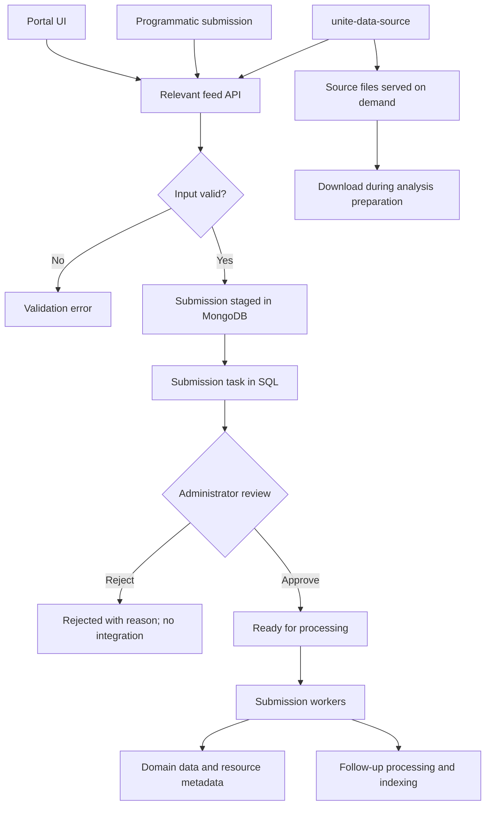

# Data ingestion and review

Last updated: 2026-10-07.

The project owner described this workflow during onboarding. Selected code paths
corroborate the main stages; this is not a complete audit of every feed or format.

## Ways data enters UNITE

1. **Portal UI**: relatively simple, modest-sized submissions, including donors
   and clinical data, donor treatments, specimens and molecular data, specimen
   drug-screening data, and images. This does not imply raw image files are
   copied to portal storage; see the existing image metadata documentation.
2. **Feed APIs**: programmatic submission. `unite-data-source` connects existing
   data locations to these APIs and serves externally stored files.

The feed components have similar responsibilities, divided by domain:

| Repository | Incoming data |
| --- | --- |
| [unite-feed-donors](https://github.com/dkfz-unite/unite-feed-donors) | Donors, clinical data, and treatments |
| [unite-feed-images](https://github.com/dkfz-unite/unite-feed-images) | Images and associated data |
| [unite-feed-specimens](https://github.com/dkfz-unite/unite-feed-specimens) | Biological specimens and associated data |
| [unite-feed-omics](https://github.com/dkfz-unite/unite-feed-omics) | Digital omics samples, results, and resources |

Omics feed is the most complex because its modalities, representations, and
formats differ substantially. Shared patterns do not imply identical behavior.

## Deep and loose integration

These terms describe how data is represented, not simply its transport or
primary-assay type. One assay can have both integrated results and hosted files.

| Aspect | Tight/deep integration | Loose/file integration |
| --- | --- | --- |
| Submitted content | Data entries and metadata | Metadata, availability, and file-access links |
| Storage after integration | Structured data in the domain database | Metadata/resources in UNITE; file contents remain at the source |
| Owner examples | Mutations, CNV/SV data, clinical and molecular data, bulk gene expression, protein expression | Heavy single-cell RNA and methylation-array resources |
| Search | Integrated values can be indexed and used in filters | Availability can be searched; remote file contents are not integrated search criteria |
| Analysis | Uses relevant integrated data | Downloads required resources during analysis preparation and analyzes them locally |

UNITE avoids relocating source files and unnecessary copies on the portal
server. Sending parsed data for integration differs from moving its original
file. Analysis downloads are part of analysis preparation; caching and retention
are method-specific; see [Analysis pipeline](analysis-pipeline.md) for retained
results and Scell temporary-input cleanup.

## `unite-data-source`

The service discovers data, associates metadata, submits to the appropriate
feed API, and hosts source files when only references should be integrated.
It does not replace feed validation, review, or domain integration.

### Deployment and data access

The owner confirmed that Data Source can run on the portal server or separately
near the original data. On the owner's current servers it runs alongside the
portal, in the local network of the data servers, and reads a mounted directory
from those servers. This gives discovery/readers filesystem access without
moving the original files into portal-managed storage.

Alternatively, Data Source can run on or near a data server to reduce file-read
latency. It submits integrated data/metadata to UNITE over the APIs and serves
resource files over HTTP for analysis preparation. Co-location and remote
placement use the same integration model.

The owner deploys Data Source through `unite-env/plugins/unite-data-source`.
That directory is not present in the currently reviewed local `unite-env`
checkout. A separate `unite-data-source-env` repository contains the plugin's
Compose and deploy/build scripts, intended for placement under `plugins/`.
Selected scripts/mounts are now reviewed in the
[Repository map](repository-map.md#installation-and-migrations); actual standalone
deployment and advertised resource reachability remain to be checked. See also
[Deployment and development](deployment-and-development.md).

### Discovery and sample sheets

- Configuration specifies data locations and the types to find.
- For sample-sheet-based types, the service looks for `<type>.tsv` in the
  configured data location. A sheet lists files and metadata needed to interpret
  and associate them; it is distinct from its referenced data files.
- If that sheet is absent, the service can invoke an executable named `crawler`
  in the configured crawler subdirectory of the configuration directory.
  The custom program scans according to its own rules and returns sample sheet
  text on standard output. A crawler discovers files; it is not a feed parser.
- The reviewed code also uploads certain simple data types directly from
  `<type>.tsv` data files. Do not assume every TSV is a sample sheet, or crawler
  fallback applies to every configured type.

Current routing in `ExploringHandler` (code-verified 2026-10-07):

| Kind | Types |
| --- | --- |
| Direct TSV data | Donor entries/treatments, MR image entries (CT routed for the future; no feed endpoint yet), specimen entries and interventions |
| Sample sheets | Omics `*.Sample` types |
| Result sheets | SM, CNV, CNV profiles, SV, methylation levels, bulk/single-cell RNA expression, protein expression |

The crawler is invoked as `<config>/<crawler>/crawler <type> <data path> <args>`.
Custom readers referenced as `cmd/<name>` resolve to
`<config>/<crawler>/readers/<name>`. Paths that escape the configured folder
through `../` are rejected and recorded in the error cache.

See the service [README](https://github.com/dkfz-unite/unite-data-source) and
[data-type documentation](https://github.com/dkfz-unite/unite-data-source/blob/main/Docs/types.md)
for configuration and sample-sheet fields.

### Submission and file hosting

- The service processes sheet entries and selects the feed for their data type.
- Deep integration submits entries together with metadata. Feed APIs can
  support several formats for the same data; reader/format metadata tells the
  system how to interpret a file. A custom reader can convert a source format.
- For resources, it submits metadata and a URL, registers a key mapped to the
  source path, and serves the file on demand.
- Required remote resources are retrieved during analysis preparation.

The reviewed result handling distinguishes standard readers, `cmd/` custom
readers, and blank readers for resource hosting. Sample-resource entries are
also hosted. Integration mode is not uniformly determined by modality alone.

### Current scheduling and tracking

The reviewed worker waits five seconds after startup, runs discovery, and waits
one minute after each pass. `config.tsv` is reloaded each pass. These are current
implementation details, not fixed product requirements.

Persistent caches record:

- `found-files.tsv`: paths whose feed request succeeded.
- `error-files.tsv`: paths whose discovery/submission handling failed.
- `host-files.tsv`: resource keys mapped to file paths.

Reviewed upload paths skip files in either the found or error cache. Successful
upload means acceptance of a submission, not approval, completed integration, or
completed indexing.

The caches are keyed only by relative path, with no content hash or
modification-time check. A path in either cache is skipped until its entry is
removed by hand, so a changed file or a failed upload is not retried
automatically. Rejecting a submission in Composer changes only the SQL task and
does not touch these caches. Each upload of a sample or resource generates a new
GUID key appended to `host-files.tsv`. Resubmission is done manually by an
administrator, by removing the path from the cache (owner, 2026-10-12). This is
fine for omics files, which almost never change; direct data sheets such as
donors may change and are also handled manually for now. Change detection for
data sheets and a management UI for Data Source, installable as a portal
plugin, are planned (Jira, Improvements and Ideas).

## Feed validation and data review

The standard owner-described path is:

1. **Validate at the feed API.** Reject malformed/unsupported input or invalid
   values. Passing validation does not mean data is already integrated.
2. **Stage the submission.** Store accepted payload/metadata in MongoDB and
   create a SQL submission task. Writing a SQL task is distinct from writing
   submitted biomedical records into domain tables.
3. **Administrator review.** Show the pending task and submitted data. Approve
   or reject with a reason.
4. **Rejection.** Do not integrate the submission. Retain the rejected submission
   and its reason in the task's `Comment`; planned cleanup is not implemented.
   The staged Mongo payload is kept as well. Approve and reject currently check
   only that the task exists, not its status, so the API does not prevent
   approving a previously rejected task.
5. **Approval and processing.** Mark the task ready. Workers integrate/write
   data and schedule relevant follow-up processing and search indexing.
   See the processing pipeline for annotation/indexing. Approval does not imply
   immediate visibility in search.

A successful API submission returns a submission number for status tracking.
Composer provides status and comment, allowing the submitter to see a review
rejection reason. The current rejection status is `Rejected`. Internal
submission-processing errors trigger another attempt rather than administrator
rejection. See [Processing pipeline](processing-pipeline.md#submission-retry-rejection-and-tracking)
for tracking and task-retention limits.

The diagram shows the standard reviewed path. All four feed APIs (donors,
images, specimens, omics) also accept `review=false`, creating a `Prepared` task
directly. Data is still staged; integration is not synchronous. The owner
confirmed this is an unused technical capability, intended for possible future
trusted automated services. Data Source always submits with the default
`review=true`; manual review is the currently used workflow.

See [Processing pipeline](processing-pipeline.md) for subsequent task handling,
annotation, and indexing.

## Selected implementation references

Reviewed locally; `main` links aid navigation and may omit unpushed changes.

- [Exploring worker](https://github.com/dkfz-unite/unite-data-source/blob/main/Unite.Data.Source.Web/Workers/ExploringWorker.cs): discovery loop and interval.
- [Exploring handler](https://github.com/dkfz-unite/unite-data-source/blob/main/Unite.Data.Source.Web/Handlers/ExploringHandler.cs): configuration, TSV/crawler fallback, readers, routes, resource URLs, and path caches.
- [File controller](https://github.com/dkfz-unite/unite-data-source/blob/main/Unite.Data.Source.Web/Controllers/FileController.cs): serves original source paths through resource keys.
- [Omics submission controller](https://github.com/dkfz-unite/unite-feed-omics/blob/main/Unite.Omics.Feed.Web/Controllers/SubmissionController.cs): validation/staging; default `review=true` creates `Preparing`, while `review=false` creates `Prepared`. The other feeds' controllers use the same switch.
- [Omics submission repository](https://github.com/dkfz-unite/unite-feed-omics/blob/main/Unite.Omics.Feed.Web/Submissions/SubmissionRepository.cs): Mongo-backed staging.
- [Composer submission review](https://github.com/dkfz-unite/unite-composer/blob/main/Unite.Composer/Admin/Services/SubmissionsService.cs): approval to `Prepared`; rejection to `Rejected` with a reason in `Comment`.
- [SM submission handler](https://github.com/dkfz-unite/unite-feed-omics/blob/main/Unite.Omics.Feed.Web/Handlers/Submission/DnaSmSubmissionHandler.cs): handles `Prepared`, writes data, schedules annotation/indexing, and deletes a successfully processed staged payload. One example does not establish every modality's behavior.

## Questions and follow-up topics

1. What is the intended procedure for changed files, failed uploads, and
   submissions rejected after successful upload? Current cache behavior is
   described above; the operational procedure needs the owner.
2. How is access to hosted resources controlled in deployment? Under review
   with the owner; check the private issue tracker before changing it.
3. Main worker, annotation, and indexing routes, submission retry/retention,
   and variant eligibility rules are documented in
   [Processing pipeline](processing-pipeline.md). Detailed recovery procedures
   remain for component-specific reviews.
4. The main search flow is documented in [Search and access](search-and-access.md).
   Availability of loose resources and deeply integrated values have different
   search roles. [Saved presets](datasets-and-portal.md) and the
   [analysis pipeline](analysis-pipeline.md) are now documented.
