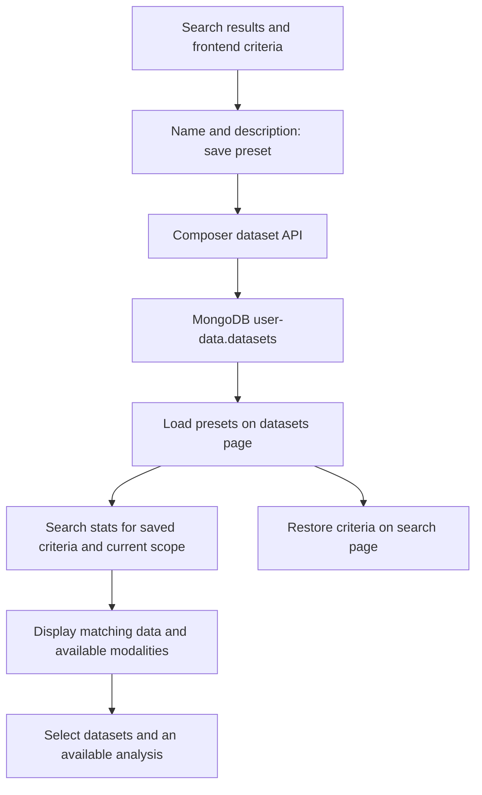

# Saved datasets and the web portal

Last updated: 2026-10-07.

The project owner explained the dataset concept and portal layout during
onboarding. Selected frontend and Composer paths confirm storage and retrieval.
The subsequent execution pipeline is documented in
[Analysis pipeline](analysis-pipeline.md).

## Dataset meaning

A saved dataset is a named preset of search criteria for a particular search
domain. For donors, it defines a cohort by its criteria. The owner's example is
that the user wants the cohort satisfying those criteria, rather than a fixed
list of the 137 donors returned by one search.

Re-running the preset evaluates its criteria against the indexed data and the
user's current accessible scope. Its result count, membership, and available
modalities can therefore change as data or access changes. Do not describe a
saved dataset as a frozen membership snapshot or assume that it guarantees
reproducible analysis inputs. An analysis records dataset criteria at launch;
its Prepare phase resolves matching data/samples and materializes input files
for Process. See [Analysis pipeline](analysis-pipeline.md). This does not
establish a universal transactional snapshot or scientific provenance format.

The reviewed save control can also add manually selected row IDs to the
criteria (donors, MR images, materials, lines, organoids, xenografts, genes,
SM, CNV and SV; not proteins). This is still a preset containing an explicit ID filter, not a
separate persisted membership list. Keep the general criteria-based model and
this optional selection constraint distinct.

## Saving and storage

The user saves the search preset from the frontend, supplies a name and an
optional description, and can later find it on the datasets page.

Composer stores the record in MongoDB:

- Database: `user-data`.
- Collection: `datasets`.
- Current record fields: `Id`, `UserId`, `Domain`, `Name`, `Description`, `Date`,
  and `Criteria`.

The frontend serializes `criteria` with `JSON.stringify`; Composer's
`DatasetModel.Criteria` is a string. Loading parses it back into criteria.
Result IDs, result counts, and availability summaries are not separate fields
in this stored model.

Account deletion, including Identity's inactivity cleanup, also removes saved
presets. This account lifecycle differs from re-evaluating a preset's matching
data; see [Identity and lifecycle](identity-and-lifecycle.md).

The reviewed frontend uses the account email as this record's `UserId`. This
storage identifier differs from the integer authenticated user ID used in
`PersonalSearchCriteria`. Do not treat the two as interchangeable.

Composer's authenticated dataset controllers provide save/delete operations
at `api/data/dataset` and list/delete-all operations at `api/data/datasets`.
Ownership handling of these endpoints is being reworked; check the private
issue tracker before changing them (see the shared
[AGENTS.md](../AGENTS.md#track-defects)). Identity's account cleanup does not use
these endpoints: it deletes presets directly in Mongo by email.

## Viewing and using datasets

The datasets page lets the user inspect saved presets, their criteria, the
amount of matching data, and available data types/modalities. Availability
helps determine which analyses can be launched for the selected datasets.

Selected implementation behavior:

1. Load and parse saved presets into the frontend store.
2. Select a dataset on the datasets page.
3. Convert its saved criteria to search criteria and call the appropriate
   domain API's `loadStats` to obtain the data/availability summary.
4. Render the summary and criteria; use selected datasets for analysis controls.
5. The dataset's Show control restores the criteria into the corresponding
   search page and navigates there to search again.

The current page requests stats when `dataset.data` is absent and keeps the
response in frontend memory. This is not a continuously refreshed membership
snapshot or an availability summary persisted alongside the Mongo preset.

Analysis controls apply method-specific requirements. For example, the reviewed
DEG dialog requires two datasets with bulk gene-expression availability. The
full set of eligibility rules and backend validation belongs to analysis
onboarding; frontend button visibility alone does not establish that every
matching entity has all data required by an analysis.

## Genomic profile

The genomic profile shows the data of one specimen together along the genome,
as far as it can be placed on the DNA axis. It is shown as the Profile tab of
specimen, donor and MR image pages (code-verified 2026-10-08).

**Backend (Composer):** `POST api/specimen/{id}/profile` with
`GenomicRangesFilterCriteria` (start/end chromosome and position, `density`,
`male`). `GenomicRangesFilterService` cuts the requested window into bins
(density 512, 1024 or 2048; bins never cross a chromosome boundary), and
`GenomicProfileService` (`Unite.Composer/Data/Omics/Ranges`) fills them from
**SQL**, not Elasticsearch:

| Data | Per bin |
| --- | --- |
| Genes | First overlapping gene at least one bin long, with strand; all genes cached in memory for 5 minutes |
| SM | Counts per impact (High, Moderate, Low, Unknown) with reference/alternative base counts; full details when the bin has one variant. Only variants with affected transcripts |
| CNV | One variant per bin (Loss > Gain > Neutral), consecutive equal bins merged; total copy number, LOH, deletion |
| SV | One variant per bin (ITX > CTX > DEL > DUP > TDUP > INS) |
| Gene expression | Raw reads, TPM and FPKM (averaged over genes in the bin) |

Protein expression is implemented in the service but disabled (the calls are
commented out), and the portal has no track for it yet; how to show it is still
open. Proteins are produced by genes but do not lie exactly on the DNA axis, so a
protein track needs its own design. CNV profiles are not part of the profile.

**Frontend:** `unite/Unite.Web/Client/src/visualization/profile`, hosted by
`domain/_shared/entry/components/tabs/ProfileTab.vue`; the unzoomed profile is
cached in local storage. Tracks: genes (plus and minus strand), SV, CNV, SM and
gene expression. Settings: SM by impact or by base change (from/to) with impact
toggles; CNV and SV on/off; expression as reads, TPM and/or FPKM (FPKM by
default).

## Downloads

Users can download most integrated data as a zip of TSV files: for a single
entry (`POST api/{donor|image|specimen|project}/{id}/data`) or for a dataset
(`POST api/{domain}/data` with search criteria). The request's data options
(`DataTypesCriteria` in `unite-composer/Unite.Composer.Download`) are: donors,
treatments, images, specimens, interventions, drug screenings, SM, CNV, SV (each
optionally with affected transcripts), gene expressions and protein expressions.
CNV profiles are included with the CNV option. Column definitions are the
mappers in `Services/Tsv/Mapping`; every omics file starts with a sample header.

Sample files of loosely integrated data (methylation arrays, single-cell RNA)
are not downloadable and not offered. The portal's shared
`_shared/components/download/DownloadForm.vue` shows only the options for which
the entry's or dataset's availability object reports data.

## Availability and statistics

Which data exists for an entry is precalculated during **indexing**, in the
feeds' indices projects (`Unite.<Type>.Indices`), not at query time:

- `DataIndex` (`unite-indices`, `Entities/DataIndex.cs`) flags available data
  per donor, image, specimen, gene, protein, variant and project: clinical data,
  treatments, image and specimen types (with molecular data, drugs and
  interventions per specimen type), and omics data (SM, CNV, CNV profiles, SV,
  methylation, bulk and single-cell expression, protein expression). It is
  computed in each index creator's `CreateDataIndex` (e.g.
  `unite-feed-donors/.../DonorIndexCreator.cs`), using `Have*` checks in
  `unite-data` repositories. `SampleDataIndex` does the same per sample.
- Datasets combine the flags of all matching entries of the dataset's own type
  (Composer's `stats` endpoints merge them into `DataResource`), which drives
  the datasets page and the download options. These are static, precalculated
  values of the selected entries, not dynamic counts per criterion.
- Per-entry `StatsIndex` counts genes and variants. Per-project statistics
  (`ProjectIndexCreator`) include donor breakdowns (age, sex, vital and
  progression status), image and specimen counts, SM/CNV/SV breakdowns, CNV
  profile, methylation, single-cell and proteomics counts, and for bulk RNA the
  25 most variable genes and the 25 most mutated genes.

A new data type usually needs its flags and counts added in all these places;
see [Integrating a new data type](integrating-a-data-type.md).

## Portal repository and code navigation

The UI is in `unite`:

| Area | Responsibility |
| --- | --- |
| `Unite.Web` | ASP.NET server hosting the Vue application and proxying requests |
| `Unite.Web/Program.cs` | SPA hosting and service proxy route setup |
| `Unite.Web/Middleware/ProxyMiddleware.cs` | Current custom reverse-proxy implementation |
| `Unite.Web/Client` | Vue.js frontend; current package scripts use Vite |
| `Client/src/domain` | Search pages and shared search/dataset-save controls |
| `Client/src/datasets` | Datasets page, components, store, record serialization, and domain API facade |
| `Client/src/analysis` | Analysis launch controls and frontend analysis views |
| `unite-composer/Unite.Composer/Data/Datasets` | Dataset storage models/services/repository |
| `unite-composer/Unite.Composer.Web/Controllers/Data/Datasets` | HTTP dataset persistence endpoints |

The portal serves the built SPA from `Client/dist` and forwards service calls
to Composer, identity, analysis, and the feed services, and `/viewer/cxg<n>`
paths to Cell-x-Gene viewer instances. Dataset persistence and
search are Composer responsibilities; rendering and preset manipulation are
frontend responsibilities. Read active `UseProxy` setup rather than assuming
the commented-out YARP configuration is the current proxy implementation.

For development, the owner runs `npm run dev` in `Unite.Web/Client` and opens
the Vite UI at `http://localhost:8080`, with the regular portal still running
at `https://localhost:443`. Vite proxies `/api/config` to the portal, while
service API routes go directly to the corresponding local service ports.
`npm run build` is mainly used for the Docker client build. See
[Frontend development](deployment-and-development.md#frontend-development-with-vite)
for the separate dev proxy configuration.

## Selected implementation references

Reviewed locally; `main` links are navigation aids, not immutable revisions.

- [Save control](https://github.com/dkfz-unite/unite/blob/main/Unite.Web/Client/src/domain/_shared/entries/components/toolbars/datasets/buttons/SaveButton.vue), [frontend dataset model](https://github.com/dkfz-unite/unite/blob/main/Unite.Web/Client/src/datasets/store/models/dataset.js), and [dataset store](https://github.com/dkfz-unite/unite/blob/main/Unite.Web/Client/src/datasets/store/index.js).
- [Datasets page](https://github.com/dkfz-unite/unite/blob/main/Unite.Web/Client/src/datasets/Page.vue), [domain API facade](https://github.com/dkfz-unite/unite/blob/main/Unite.Web/Client/src/datasets/api/index.js), and [Show control](https://github.com/dkfz-unite/unite/blob/main/Unite.Web/Client/src/datasets/components/dataset/controls/buttons/ShowButton.vue).
- [Stored model](https://github.com/dkfz-unite/unite-composer/blob/main/Unite.Composer/Data/Datasets/Models/DatasetModel.cs) and [Mongo repository](https://github.com/dkfz-unite/unite-composer/blob/main/Unite.Composer/Data/Datasets/Repositories/DatasetsRepository.cs).
- [Dataset controller](https://github.com/dkfz-unite/unite-composer/blob/main/Unite.Composer.Web/Controllers/Data/Datasets/DatasetController.cs) and [datasets controller](https://github.com/dkfz-unite/unite-composer/blob/main/Unite.Composer.Web/Controllers/Data/Datasets/DatasetsController.cs).
- [DEG eligibility example](https://github.com/dkfz-unite/unite/blob/main/Unite.Web/Client/src/analysis/components/deg/Dialog.vue).
- [Portal startup](https://github.com/dkfz-unite/unite/blob/main/Unite.Web/Program.cs), [proxy middleware](https://github.com/dkfz-unite/unite/blob/main/Unite.Web/Middleware/ProxyMiddleware.cs), and [frontend package](https://github.com/dkfz-unite/unite/blob/main/Unite.Web/Client/package.json).

## Next discussion

The saved-preset model, storage, datasets page, and main portal layout are now
documented. The request, Prepare/Process phases, files, results, and Scell viewer
are covered in [Analysis pipeline](analysis-pipeline.md). Detailed per-method
eligibility and scientific input/output contracts remain for component reviews.
