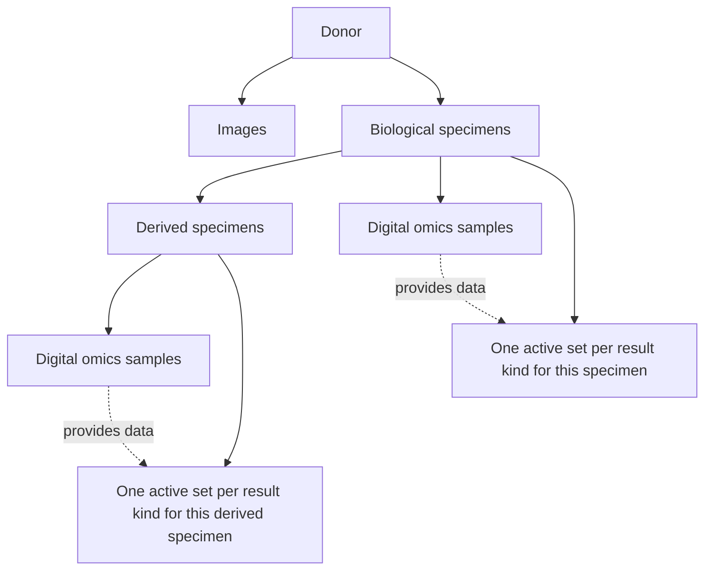

# UNITE domain model

Last updated: 2026-10-12.

The domain rules below were explained by the project owner during onboarding.
Selected local code references corroborate parts of the model; they do not
establish that all intended behavior is implemented throughout the platform.

## Main domain repository

The owner confirmed that the domain's data types and entities are primarily
defined in [unite-data](https://github.com/dkfz-unite/unite-data).

- `Unite.Data/Entities`: entity definitions, enums, and relationships. Main
  groups include `Donors`, `Images`, `Specimens`, and `Omics`.
- `Unite.Data.Context/Mappers`: database mappings and required fields.
- `Unite.Data.Context`: the database context and related data services.

The owner uses code-first EF models with explicit Fluent API mapping classes
under `Unite.Data.Context/Mappers` for tables, keys, relationships, conversions
and required fields; the context applies those configurations. Column names
are currently declared with `[Column("...")]` attributes on the entity
properties (about half of the `Unite.Data` files), not in the mappers.
Domain SQL migrations live separately in `unite-data-migrations`; identity data
has its own database and migration repository. See
[SQL models and migrations](sql-migrations.md) for the project layout and workflow.

Start there to understand what data the platform represents. Feed services,
search/access services, and analysis services supply additional behavior; their
rules cannot be established from entity definitions alone.

## Donor

A donor represents anonymized patient data and is the central entity linking
biomedical modalities. No donor-associated biomedical record exists without a
donor. This rule concerns the biomedical domain, not standalone infrastructure
objects such as users or reference databases.

The term is deliberately broader than "human patient": a non-human donor, such
as a mouse, is a possible future extension, not a confirmed current capability.
The initial research focus is oncology.

A donor can have zero or more project assignments, clinical and treatment data,
multiple biological specimens, and multiple images.

## Projects and visibility

A project is primarily a grouping/statistical unit for donors or research.
The precise relationship between projects and studies, and project statistics,
will be discussed later. Every donor belongs to at least one project: a donor
created without one (by any feed) is assigned to the default project `Other`
(`Project.DefaultName`).

The owner described these visibility rules:

- Every user sees every project, public or private, with its description and
  its assigned users, so that users know whom to contact for access to a
  private project's data. Only administrators assign or remove project users.
- Data associated with a private project (donors, images, specimens, omics) is
  visible only to users added to that project.
- Data associated with a public project is visible to any platform user.
  "Public" here does not mean anonymous internet access. The default project
  `Other` is public, so donors submitted without a project are visible to
  everyone. Search scopes donors by project, so a donor with no project at all
  would be visible to no one; the feeds (fixed 2026-10-07) and the
  `DefaultProject` migration ensure that every donor has a project. The
  migration (branch `fix/default-project-public` in `unite-data-migrations`)
  is not merged yet; until it is deployed, `Other` stays private and older
  project-less donors stay hidden.
- Projects are **private on creation**, by design: data pushed into a new
  project must not become visible to everyone because someone forgot to mark it
  private. An administrator makes a project public explicitly. The
  `DataUserProject` migration accordingly set all existing projects to private.
- If a donor belongs to both a public and a private project, the public
  assignment makes its data visible. The owner expects this combination to be
  rare, if it occurs at all.

Private projects are under development. The current data model has
`Project.IsPublic` and project-user associations: `ProjectUser` links a project
to a `DataUser`, whose `UserId` holds the Identity user ID (migration
`DataUserProject`, 2026-08-12). Enforcement is still being completed; see
[Search and access](search-and-access.md#personal-criteria-and-project-visibility). The owner has confirmed the public/private overlap rule; visibility
when a donor belongs only to several private projects remains to be clarified.
Worker-token scope for private projects is explicitly not yet defined. Public
instance registration is a separate setting; see
[Identity and lifecycle](identity-and-lifecycle.md).

The owner identified personalized search as the shared visibility mechanism
for user data access and analysis data selection. Selected project-scope and
Composer paths are described in [Search and access](search-and-access.md);
complete enforcement remains to be verified with the private-project work.

## Saved datasets and cohorts

A saved dataset is a named search-criteria preset, with a description and search
domain, persisted in MongoDB `user-data.datasets`. For donors, the preset
defines a cohort by its criteria. Matching entities are determined when the
criteria are evaluated; the saved model has no separate membership snapshot.
Optional selected IDs can be part of the criteria. See
[Datasets and portal](datasets-and-portal.md).

Saved user presets are distinct from project grouping/statistical units. The
precise relationship between projects and studies remains to be discussed.

## Images and biological specimens

Images and specimens are separate branches beneath the donor. The owner
described imaging examples such as MRI and CT. Current code has `ImageType`
`MR` and `CT`; only MR has a dedicated subtype entity (`MrImage`).

Images are not directly linked to a biological specimen: the platform cannot
reliably identify which primary, recurrent, or metastatic tumor a particular
image represents. Do not infer an image-to-specimen association from their
shared donor.

A specimen is biological material, distinct from a digital sample. A donor can
have multiple specimens, including healthy material used as a sequencing
comparison, primary tumor material, recurrent tumor material, and metastases.
These descriptions are distinct from the specimen's type: in code they are
`Specimen.Category` (`Normal`, `Tumor`) and `Specimen.TumorType` (`Primary`,
`Metastasis`, `Recurrent`).

Specimen types include:

- `Material`: donor-derived material, for example tissue or cerebrospinal fluid.
- `Line`: a cell line.
- `Organoid`.
- `Xenograft`.

Specimens form a derivation hierarchy. For example, a cell line can derive from
donor material, and further specimens can derive from that line. This is an
example of a workflow, not an exhaustive list of allowed parent-child pairs.
Each specimen can have its own set of omics samples.

## Digital samples and results

A sample is an analyzed digital sample associated with a biological specimen.
In the current code, its required `AnalysisId` points to `Omics.Analysis`, which
describes the **primary assay**, for example WGS or WES. It does not describe a
variant-calling analysis or an analysis a user runs on a saved dataset.

The owner and a colleague plan to rename this concept to **Primary Assay**.
This document explains that intended terminology; the code and API still use
`Analysis`, `AnalysisId`, and `analysis_type`. No rename has been performed as
part of onboarding.

Depending on the modality and experiment, a sample can provide:

| Modality | Data described by the owner |
| --- | --- |
| DNA sequencing | Simple mutations (SM), copy number variants (CNV), structural variants (SV), and CNV profiles, depending on the sequencing method |
| Bulk RNA sequencing | Gene expression |
| Single-cell RNA sequencing | Single-cell expression data; detailed handling remains to be discussed |
| Methylation arrays | Methylation data; can also provide CNV profiles |
| Proteomics | Protein expression/abundance |

RNA gene fusions are planned; they must not be presented as an already available
feature.

Use **SM (simple mutations)** instead of **SSM (simple somatic mutations)** as
the general category. These mutations can be somatic or germline, so "somatic"
would incorrectly narrow the category.

## Genome build

The genome build (GRCh37 or GRCh38) is a property of the portal instance
(`UNITE_GENOME_BUILD` in the omics feed). It determines which Ensembl VEP and
Ensembl Data builds are installed, and therefore which build annotation and
indexing use. Owner-confirmed rules (2026-10-07):

- Data integrated by nucleotide position must be in the instance's build:
  variants (SM, CNV, SV), CNV profiles, and gene and protein expression.
  Genes and proteins themselves are matched by name or Ensembl ID, but variant
  positions differ between builds.
- Loosely integrated data, currently methylation arrays and single-cell RNA, may
  come from another build. Methylation is planned to be integrated more tightly,
  and will then probably have to match the instance's build as well.

Each submitted sample declares its `genome`; validation requires `GRCh37` or
`GRCh38` but does not yet compare it with the instance's build (tracked in
Jira).
[unite-genome-liftover](repository-map.md#additional-local-repositories) is a
draft for converting data between builds.

## Intentional constraints

Modality data can be deeply integrated as structured values or loosely
integrated as metadata/resource links. Availability of a modality is not proof
that its measurement values are searchable. See
[Data ingestion](data-ingestion.md#deep-and-loose-integration).

Combined search criteria for a specimen and a mutation must match the same
specimen. A mutation in another specimen of the same donor does not satisfy
that combination. See [Search and access](search-and-access.md).

The owner explained the following simplification:

1. Each specimen has at most one sample of a given modality/data type. For
   DNASeq, WGS and WES are alternative primary-assay subtypes of the same slot:
   one WGS sample and one WES sample on the same specimen are not supported.
   Multiple parallel samples of the same modality are not the intended model.
2. A sample can contain several result kinds, such as SM, CNV, and SV for DNA.
3. Each result kind has one active set of results **per specimen**, regardless
   of the primary assay or sample from which the data came. For example,
   CNVProfiles from WGS and MethArray contribute to the same specimen-level
   data, rather than parallel assay-specific result sets. "One set" does not
   mean only one variant, profile entry, or measurement.
4. Repeated uploads merge or replace the relevant data rather than expose
   multiple alternative result runs. Owner-confirmed intent (2026-10-07):
   - sample metadata: **upsert**: new samples are created, provided fields are
     updated, missing fields stay untouched; the submission endpoints cannot
     clear a value;
   - SM: **merged**, because SNVs and INDELs usually arrive as two independent
     uploads;
   - CNV, SV and CNV profiles: **replaced** per sample;
   - bulk gene expression and protein expression: replaced per sample;
   - resources (files): **upsert**, because files can be uploaded separately;
   - lists attached to an entity (donor projects, studies and treatments,
     specimen interventions, drug screenings, radiomics features): **replaced**
     when provided, kept when omitted (owner-confirmed 2026-10-12).

   A general switch to "replace" for everything except SM is under
   consideration (Jira, Improvements and Ideas).

   Deleting individual values or results through submissions is not supported
   and has not been needed: quality control happens before data reaches the
   portal. Whole entries (donor, project, image, specimen) can be deleted
   through the feeds' `DELETE` endpoints, which the portal offers to users with
   `Data.Write`. Current code differs for CNV and SV,
   which are still merged like SM, and for CNV profiles, which are upserted per
   chromosome arm (tracked in Jira). Single-cell data has not been checked.

This restriction is intentional: representing multiple same-type samples and
competing result runs would substantially complicate the system. Do not expand
this model to track parallel samples or runs without an explicit domain change.
This statement does not establish anything about internal audit/history storage.

The DNASeq/WGS/WES boundary and specimen-level result uniqueness were explicitly
confirmed by the owner. The grouping of other assay subtypes and the exact
merge/replace behavior will be documented with the relevant feed workflows.

## Implementation verification notes

- `Sample.AnalysisId` is a non-nullable integer and is marked required by the
  base sample mapper. The omics mapper defines its foreign-key association to
  `Analysis`.
- The DNA sample endpoint accepts WGS and WES. The CNVProfile endpoint accepts
  WGS, WES, and MethArray, corroborating that profiles can come from different
  primary assays.
- `SampleRepository.Find` matches donor reference ID, specimen reference ID,
  specimen type and exact `Analysis.TypeId`.
- The CNV profile mapper stores a `SampleId` foreign key, and
  `ProfileRepository.Find` looks up entries by sample, chromosome, and arm.

**The owner-confirmed constraints are not enforced in code** (verified
2026-10-07). The only unique index on `omics.sample` is on `AnalysisId`; there
is none on specimen plus assay type, and none on CNV profiles. Feed validation
checks only that the assay type is allowed for the endpoint, and
`DataWriter.WriteSample` creates a new sample when the exact type differs. So
submitting WES for a specimen that already has a WGS sample creates a second
sample, and WGS and MethArray CNV profiles of one specimen are stored and
indexed separately. Read paths outside unite-feed-omics have not been checked
for per-specimen collapsing. Until enforcement exists, the constraints are a
data-management convention. They remain the intended model.

## Selected code references

Reviewed in the local working checkouts during onboarding:

- [Donor](https://github.com/dkfz-unite/unite-data/blob/main/Unite.Data/Entities/Donors/Donor.cs): specimen, image, project, and study associations.
- [Project](https://github.com/dkfz-unite/unite-data/blob/main/Unite.Data/Entities/Donors/Project.cs): public flag and project-user associations; access enforcement is not established by this class.
- [Specimen](https://github.com/dkfz-unite/unite-data/blob/main/Unite.Data/Entities/Specimens/Specimen.cs): parent/children and omics sample associations.
- [Omics sample](https://github.com/dkfz-unite/unite-data/blob/main/Unite.Data/Entities/Omics/Analysis/Sample.cs): matched sample and result collections.
- [Base sample](https://github.com/dkfz-unite/unite-data/blob/main/Unite.Data/Entities/Base/Sample.cs) and [base sample mapper](https://github.com/dkfz-unite/unite-data/blob/main/Unite.Data.Context/Mappers/Base/SampleMapper.cs): required `AnalysisId`.
- [Sample lookup](https://github.com/dkfz-unite/unite-feed-omics/blob/main/Unite.Omics.Feed/Data/Repositories/SampleRepository.cs): `Find` and `FindOrCreate` identify and reuse a sample by its donor/specimen and assay type.
- [Assay type enum](https://github.com/dkfz-unite/unite-data/blob/main/Unite.Data/Entities/Omics/Analysis/Enums/AnalysisType.cs): WGS and WES are distinct values. Enum membership alone does not establish end-to-end modality support.
- [DNA sample endpoint](https://github.com/dkfz-unite/unite-feed-omics/blob/main/Unite.Omics.Feed.Web/Controllers/Dna/SampleController.cs): WGS and WES are accepted assay subtypes.
- [CNVProfile endpoint](https://github.com/dkfz-unite/unite-feed-omics/blob/main/Unite.Omics.Feed.Web/Controllers/Dna/CnvProfileController.cs): accepts WGS, WES, and MethArray.
- [CNV profile repository](https://github.com/dkfz-unite/unite-feed-omics/blob/main/Unite.Omics.Feed/Data/Repositories/Dna/Cnv/ProfileRepository.cs) and [mapper](https://github.com/dkfz-unite/unite-data/blob/main/Unite.Data.Context/Mappers/Omics/Analysis/Dna/Cnv/ProfileMapper.cs): current sample-keyed storage and update paths.
- [SM submission documentation](https://github.com/dkfz-unite/unite-feed-omics/blob/main/Docs/models-dna-sm.md): current general term is simple mutations.

Links target `main` for navigation. Local working checkouts may contain changes
not yet reflected there; these are not immutable revision citations.

## Open questions

1. If a donor belongs only to several private projects, is membership in any
   one of them sufficient to see all its associated data? Revisit with access
   control; the public/private overlap case is already confirmed.
2. Re-upload intent is confirmed for all deeply integrated kinds and
   resources; how single-cell data should behave remains to be checked.
3. Should the combined DNASeq slot and specimen-level result uniqueness be
   enforced in code (database constraint, feed validation, or both)? They are
   currently not enforced.
4. What is the exact relationship between a project and a study? How are project
   statistics calculated? Saved datasets are user search presets, as documented
   above; revisit the remaining grouping/statistics details with projects.
