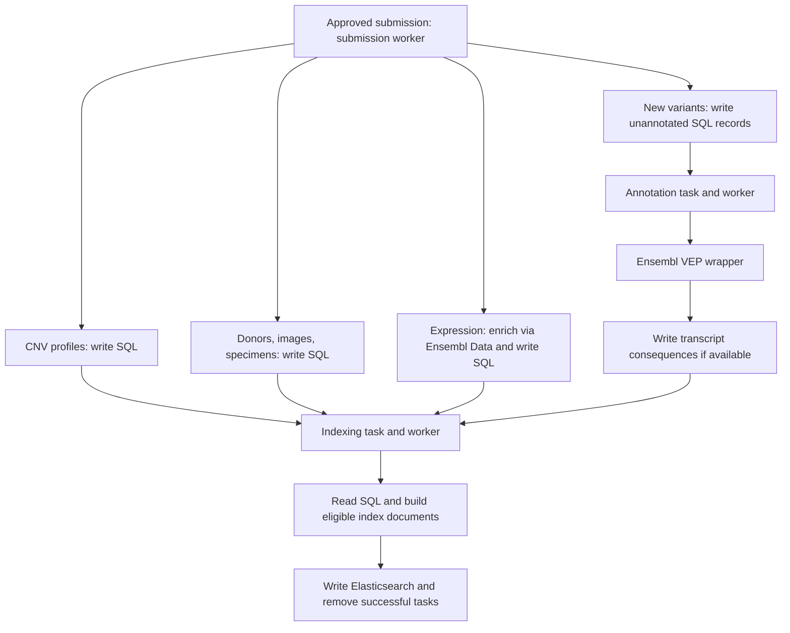

# Submission processing, annotation, and indexing

Last updated: 2026-10-07.

This follows [data ingestion and review](data-ingestion.md). The owner explained
the pipeline, submission retry/retention, and variant indexing rules; selected
local handlers confirm the main routes. Modality-specific updates and recovery
edge cases have not yet been fully reviewed.

## Task vocabulary

The owner described `null`, `Preparing`, `Prepared`, `Processing`, `Processed`,
and `Failed`. The current enum also includes `Rejected` for review rejection.
`null` is an unset nullable status, not an enum member.

| Status | Meaning and scope |
| --- | --- |
| `null` | Unset status; current bulk annotation/index task creation can use it. It does not mean awaiting review. |
| `Preparing` | For a submission, waiting for administrator review. Other task types may use it differently. |
| `Prepared` | For a submission, ready for its worker after approval. The currently unused `review=false` path also creates it. |
| `Processing` | Work in progress in the general vocabulary; persisted transitions depend on task implementation. |
| `Processed` | Completion in the general vocabulary; not every completed task remains stored. |
| `Failed` | A separate failure status in the general task enum, used for analysis errors. The reviewed administrator rejection path uses `Rejected`, not this value. |
| `Rejected` | Submission rejected by an administrator, with a reason. |

This is not a mandatory universal sequence. Reviewed submission handlers select
`Prepared`; annotation/index handlers select their task type without requiring
the same start status. Their processing-service overloads remove successfully
handled tasks while the corresponding worker remains active. Status-transition
overloads retain tasks instead: the synchronous one sets the supplied end
status, while the current async variant saves the tasks without assigning it
(`TaskProcessingService.cs`, likely a bug).

### Stage gating

Workers of later stages wait for earlier ones across the shared task table.
Annotation handlers return early while any submission task is pending, and
indexing handlers return early while any submission or annotation task is
pending. Submission tasks in `Preparing` (awaiting review) or `Rejected` do not
count as pending, so review does not block processing.

SQL task removal and Mongo staged-payload deletion are distinct. The reviewed
successful submission handlers delete their staged payload, and the processing
service removes the task. Do not infer durable processed-task history or
identical failure handling for every task type.

## Submission retry, rejection, and tracking

The owner confirmed that an internal submission-processing error triggers
another processing attempt. It does not mean administrator rejection. The
reviewed worker catches/logs handler exceptions and continues its loop; the
processing service removes a task only after successful handling. A retained,
eligible submission can therefore be picked up again. The base worker pauses
ten seconds between cycles (submission and indexing workers); the omics
`VariantsAnnotationWorker` has its own hard-coded ten-second delay and
configurable SM/CNV/SV bucket sizes. There is no backoff, and transactionality
or idempotency is not established for every handler.

Because submission handlers take the oldest `Prepared` task of their type first,
a submission that fails permanently is retried every cycle ahead of later ones
of the same type. Through stage gating it also holds back annotation and
indexing across all feeds until it is fixed or removed (inferred from code).

In conversation, the owner called rejected submissions "failed". The current
administrator service and portal use the exact status `Rejected`; the reason
is stored in the task's `Comment`. Keep that spelling when discussing API/code
behavior, and distinguish rejection from an internal error that is retried.

A successful feed submission returns a submission number (SQL task ID), which
can be used to track status. Composer's submission-status service returns both
the status and comment, and the portal displays the rejection reason. The
portal's status labels are currently misleading: `Preparing` (awaiting review)
is shown as "Processed" and `Prepared` as "Approved"; a successfully processed
submission, whose task has been removed, is reported as "not found". Rejected
submissions are retained. Cleanup after a retention period was planned but is
not implemented; there is no confirmed expiry interval.

Successful task removal means this status interface is not a permanent history
of all submissions. The reviewed service returns no status record when the
task is absent; absence alone does not explain why it is missing. Automatic
processing retry is also distinct from re-uploading through data-source and
its path caches.

## Donors, images, and specimens

1. A submission worker picks up an approved (`Prepared`) submission task.
2. It loads the staged submission and writes domain records into SQL.
3. It creates indexing tasks for affected entities and closes the submission.
4. An indexing worker reads current SQL records, constructs index documents,
   and writes them to Elasticsearch.
5. Successfully processed indexing tasks are removed.

The index derives from SQL data, not directly from the raw upload. Submission
completion does not imply completed indexing or immediate search visibility.

## Omics: variants

1. Submission writes variant records and associations into SQL, initially
   without transcript-consequence annotations, and creates annotation tasks.
2. The annotation worker reads variants and calls the custom Ensembl VEP web
   wrapper to obtain transcript consequences.
3. It writes affected-transcript data into SQL and creates indexing tasks.
   The domain includes `VariantAffectedTranscript` and concrete variant
   affected-transcript entities.
4. Indexing reads SQL, writes Elasticsearch documents, and removes successful
   tasks.

"Unannotated" does not mean a variant lacks identity or coordinates. This stage
is not variant calling and is distinct from the sample's Primary Assay.

The owner confirmed that a variant with no transcript consequences is still
indexed; its annotation task is removed. An empty consequence result must not
be automatically treated as a failed task or as grounds for search exclusion.

### Neutral CNV exception

Fully neutral CNV without loss of heterozygosity (LOH) remain in SQL but are
excluded from indexing. The current `IsInfluentCnv` predicate excludes exactly
`TypeId == CnvType.Neutral && Loh == false`. The LOH field is nullable: do not
silently treat an unknown value as explicit `false` when translating this rule.
In current code a neutral CNV with unknown (`null`) LOH is therefore treated as
influent, annotated and indexed.
The DNA writer stores CNV records/entries, while annotation scheduling and index
entry loading apply the eligibility predicate.

This rule concerns CNV variant records, not an exclusion of all CNVProfiles or
all variants without consequences. Search indexes are a selected projection
of SQL data; SQL persistence does not guarantee an Elasticsearch document.

The reviewed SM submission handler also creates indexing tasks directly for
some entries of existing variants. The route above describes new variants;
repeat-upload behavior will be covered in a later modality-specific review.

## Omics: CNV profiles

`CnvProfileSubmissionHandler` (`DNA_CNVP`, `Prepared`) writes profiles and
creates CNV-profile indexing tasks directly, without an annotation stage.
`CnvProfilesIndexingHandler` runs in the omics `IndexingWorker`. Since commit
`98cb73e` (2026-08-14) the omics full reindex also covers the CNV-profile index.

## Omics: gene and protein expression

Enrichment occurs inside submission processing:

1. Load the staged expression submission.
2. Query `unite-ensembl-data` for additional gene/protein information.
3. Write the enriched records and expression data into SQL.
4. Create indexing tasks and close the submission.
5. Index from SQL into Elasticsearch and remove successful indexing tasks.

This does not use the separate VEP annotation-task stage. Calling an annotation
service within a submission handler differs from scheduling an annotation task.

This diagram shows the main routes. An empty transcript-consequence result
still proceeds to indexing, subject to independent eligibility rules such as
the neutral CNV exception. Recovery edge cases and updates of existing data
remain for component-specific discussions.

## Code navigation

[unite-indices](https://github.com/dkfz-unite/unite-indices) is the main source
for index types and shapes: `Unite.Indices/Entities` defines documents,
`Unite.Indices.Context` supplies index services, and `Unite.Indices.Search`
contains the search engine. Discuss search semantics after processing.

Conceptual feed areas map to these actual local project names:

| Responsibility | Projects |
| --- | --- |
| Domain writing/integration | `Unite.Donors.Feed`, `Unite.Images.Feed`, `Unite.Specimens.Feed`, `Unite.Omics.Feed` |
| HTTP API and workers/handlers | Corresponding `Unite.<Type>.Feed.Web` projects |
| Index construction | `Unite.Donors.Indices`, `Unite.Images.Indices`, `Unite.Specimens.Indices`, `Unite.Omics.Indices` |
| Omics annotation services/clients | `Unite.Omics.Annotations` |

The owner's terms "feed indexing" and "feed annotation" describe these areas;
do not search only for literal `.Feed.Indexing` or `.Feed.Annotation` names.

Retrieving staged submission data for administrator review is the notable feed
read operation identified by the owner. Feed APIs primarily ingest data;
they are not the general integrated-data search/read interface.

## Ensembl wrappers

- **unite-ensembl-vep:** custom web wrapper around Ensembl VEP with local
  file-based Ensembl reference cache data. The owner aims to update releases
  when practical; this does not establish that a deployment is on the latest
  version. The reviewed Dockerfile pins `release_113.4`; deployed versions and
  the update procedure remain to be reviewed. This reference cache differs
  from data-source path caches or Mongo submission staging.
- **unite-ensembl-data:** custom API over a downloaded Ensembl database on
  legacy MySQL. The owner confirmed only required parts/tables are populated;
  do not assume a complete Ensembl database. The README describes access to
  genes, transcripts, and proteins.

The reviewed variant loader uses VEP for consequences and Ensembl Data for
related gene/transcript information. Expression enrichment uses Ensembl Data
directly. The services serve different purposes.

## Selected implementation references

Reviewed locally; `main` links aid navigation and may omit unpushed changes.

- [Task enum](https://github.com/dkfz-unite/unite-data/blob/main/Unite.Data/Entities/Tasks/Enums/TaskStatusType.cs), [creation](https://github.com/dkfz-unite/unite-data/blob/main/Unite.Data.Context/Services/Tasks/TaskService.cs), and [TasksProcessingService](https://github.com/dkfz-unite/unite-data/blob/main/Unite.Data.Context/Services/Tasks/TaskProcessingService.cs).
- [Omics worker](https://github.com/dkfz-unite/unite-feed-omics/blob/main/Unite.Omics.Feed.Web/Workers/Worker.cs), [submission review](https://github.com/dkfz-unite/unite-composer/blob/main/Unite.Composer/Admin/Services/SubmissionsService.cs), [submission status](https://github.com/dkfz-unite/unite-composer/blob/main/Unite.Composer/Data/Submissions/SubmissionsService.cs), and [portal tracking](https://github.com/dkfz-unite/unite/blob/main/Unite.Web/Client/src/domain/submissions/Page.vue).
- [CNV eligibility predicate](https://github.com/dkfz-unite/unite-data/blob/main/Unite.Data.Context/Repositories/Constants/Predicates.cs), [DNA writer](https://github.com/dkfz-unite/unite-feed-omics/blob/main/Unite.Omics.Feed/Data/Writers/Dna/AnalysisWriter.cs), and [variant indexing cache](https://github.com/dkfz-unite/unite-feed-omics/blob/main/Unite.Omics.Indices/Services/VariantIndexingCache.cs).
- [Donor submission](https://github.com/dkfz-unite/unite-feed-donors/blob/main/Unite.Donors.Feed.Web/Handlers/Submission/DonorsSubmissionHandler.cs) and [donor indexing](https://github.com/dkfz-unite/unite-feed-donors/blob/main/Unite.Donors.Feed.Web/Handlers/DonorsIndexingHandler.cs).
- [SM submission](https://github.com/dkfz-unite/unite-feed-omics/blob/main/Unite.Omics.Feed.Web/Handlers/Submission/DnaSmSubmissionHandler.cs), [SM annotation](https://github.com/dkfz-unite/unite-feed-omics/blob/main/Unite.Omics.Feed.Web/Handlers/Annotation/SmsAnnotationHandler.cs), and [SM indexing](https://github.com/dkfz-unite/unite-feed-omics/blob/main/Unite.Omics.Feed.Web/Handlers/Indexing/SmsIndexingHandler.cs).
- [Variant annotation loader](https://github.com/dkfz-unite/unite-feed-omics/blob/main/Unite.Omics.Annotations/Services/Vep/AnnotationsDataLoader.cs) and [effects writer](https://github.com/dkfz-unite/unite-feed-omics/blob/main/Unite.Omics.Feed/Data/Writers/Dna/EffectsWriter.cs).
- [RNA expression submission](https://github.com/dkfz-unite/unite-feed-omics/blob/main/Unite.Omics.Feed.Web/Handlers/Submission/RnaExpSubmissionHandler.cs) and [protein expression submission](https://github.com/dkfz-unite/unite-feed-omics/blob/main/Unite.Omics.Feed.Web/Handlers/Submission/ProtExpSubmissionHandler.cs).
- [VEP Dockerfile](https://github.com/dkfz-unite/unite-ensembl-vep/blob/main/Dockerfile) and [Ensembl Data README](https://github.com/dkfz-unite/unite-ensembl-data/blob/main/README.md).

## Questions for the next discussion

The main processing and [search model](search-and-access.md) are now documented.
Saved presets and the separate [analysis pipeline](analysis-pipeline.md) are
also documented; analyses retain tasks and require manual restart after errors.
Detailed recovery after partial
writes, annotation/indexing errors, and repeat uploads can be covered during
the respective component reviews.
