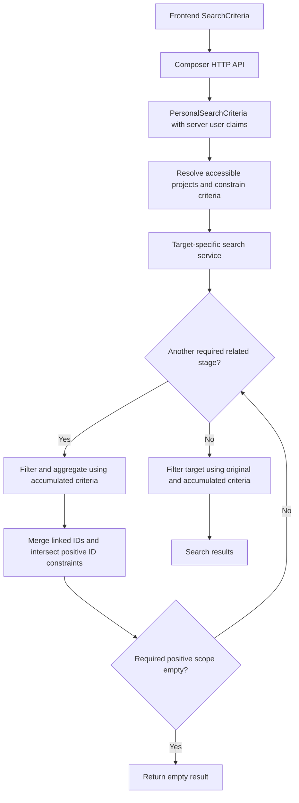

# Search, cross-reference filtering, and access

Last updated: 2026-10-12.

The owner explained the search design during onboarding. Selected local models,
search services, and Composer endpoints corroborate the main flow. This is not
a complete audit of every query path or the private-project feature, which is
under development.

## Responsibility and code layout

`unite-indices` is a library repository, like `unite-data`; it does not expose
its own HTTP API. `unite-composer` provides the web API for indexed data access.

| Project / area | Responsibility |
| --- | --- |
| `Unite.Indices` | Index document models and compact navigation models |
| `Unite.Indices.Context` | Elasticsearch connection/configuration and basic index write/delete services |
| `Unite.Indices.Search/Engine/Filters` | Generic filters implementing `IFilter<T>` |
| `Unite.Indices.Search/Engine/Extensions` | Translation/composition of Elasticsearch queries, requests, and aggregations |
| `Unite.Indices.Search/Engine/Queries` | `SearchQuery<T>`, `GetQuery<T>`, and `SearchResult<T>` |
| `Unite.Indices.Search/Engine` collection services | Low-level queries against individual index collections |
| `Unite.Indices.Search/Services` | Domain-specific search orchestration and cross-reference filtering |
| `Services/Filters/Criteria` | Aggregate `SearchCriteria` and server-side personal criteria |
| `Services/Filters/Base` | Reusable domain criteria and filters |
| `Services/Filters/*FiltersCollection` | Filters applicable to a particular document type |

Context services and Search/Engine services have similar names but different
responsibilities: inspect their project/namespace before changing them.

The search engine uses Elasticsearch 7.17 through the NEST 7.17 client. A move
to Elasticsearch 8 (new client) or replacing Elasticsearch with SQL-only search
are future options without a decision; with two developers, even a driver
migration is a large task (owner, 2026-10-09).

## Separate collections and compact navigation

**Why the design looks like this** (owner, 2026-10-09): originally a single
donor document contained everything, and one query with all filters on one
collection was enough. As the number of donors grew, Elasticsearch could no
longer handle documents of that size. Collections were therefore made into
simple, non-normalized views of one entity each: a document holds only the
entity's own information plus navigation properties (essentially IDs) to the
connected entities in other collections. The price is the cross-reference
search below: each criteria group is evaluated in its own collection and the
results are intersected. Negative filters (single criteria and whole groups)
were added later and are the most intricate part.

Collections hold their own documents; related documents are represented by
compact navigation objects rather than a complete embedded biomedical graph.

Current index names include projects, donors, images, specimens, genes, gene
expressions, proteins, protein expressions, SM, CNV, SV, and CNV profiles.
Consult `Unite.Indices.Context/Constants/IndexNames.cs` for exact names.

Examples from the reviewed models:

- `DonorIndex.Specimens` is an array of donor-specific `SpecimenIndex` objects
  inheriting `Basic.Specimens.SpecimenNavIndex`, with sample summaries. It is
  not an array of full standalone specimen documents.
- `SpecimenNavIndex` contains `Id`, `ReferenceId`, and specimen `Type`.
- Variant documents, such as `SmIndex`, contain `Specimens` navigation objects
  identifying the specimens in which the variant occurs. Other fields include
  variant information, affected features, statistics, and availability.

Navigation objects can carry more than an ID while remaining much smaller than
the full related data. A navigation projection between images and specimens is
not proof of a direct biological image-to-specimen association; see the
[domain model](domain.md#images-and-biological-specimens).

## Criteria and filters

The frontend submits a `SearchCriteria` combining pagination/full-text search
with criteria for different data types. The target collection and the criteria
types are separate: a donor search can include mutation criteria, and a mutation
search can include donor diagnosis criteria.

The current class includes `Project`, `Donor`, `Image`, `Mr`, `Specimen`,
`Material`, `Line`, `Organoid`, `Xenograft`, `Gene`, `Protein`, `Sm`, `Cnv`,
`Sv`, and `CnvProfile`, plus `From`, `Size`, and `Term`. Default pagination is
`From = 0`, `Size = 20`. Presence in the aggregate class does not establish
support for every criterion on every target collection or in every UI screen.

Domain filters connect a criterion to an index property and a generic filter.
`IFilter<T>.CreateQuery()` produces an Elasticsearch query; extensions compose
these into requests and aggregations. Each `FiltersCollection` assembles the
filters supported by its document type. Adding a criterion property alone does
not make it searchable: trace the collection filters and service orchestration.

## How entities are connected

The connections follow the real structure of the data (owner, 2026-10-09):

- A donor has images and specimens. A specimen has samples, and each sample
  provides omics data (variants, expressions, profiles). The **specimen is
  the hub**: omics collections point to specimens, so omics stages collect
  specimen IDs and intersect them with what was found or set before.
- Genes and variants are connected in two independent ways:
  1. **By position**: a variant affects a region or point of a gene.
  2. **Through expression in the same specimen**: the same specimen may have
     gene expression data (from another sample), so variants can be filtered by
     how the genes they affect are expressed.
- Proteins work the same way: variants affect proteins indirectly through
  genes, and protein expression of the same specimen (another sample) connects
  to the variants through the specimen.

Example: specimen SP1 has an RNA sample (gene expressions) and a WES sample
(mutations). Mutation M1 affects gene G1, and G1 is expressed in SP1. Users can
then filter donors that have or do not have a mutation in G1, donors where G1
is expressed at some level, and donors where G1 is expressed at some level
**and** carries M1, all resolved through SP1.

## Sequential cross-reference search

The owner described this main strategy:

1. Establish the current user's allowed scope and combine it with the request.
2. Work through the related collections in the target service's order. Skip
   stages whose criteria are absent.
3. At each required stage, filter/aggregate the related collection using the
   current accumulated criteria and collect the relevant linked IDs.
4. Merge the IDs into those criteria. For positive constraints, intersect with
   any existing IDs for the same entity type; if no ID constraint exists yet,
   use the found IDs. Each later stage sees the updated criteria.
5. Return an empty search result immediately if a required positive stage
   finds no IDs or its intersection is empty. Do not run the final target query
   after the required scope has become empty.
6. After all needed stages, filter the target collection using the supported
   original criteria together with the accumulated constraints and return its
   documents.

**Stage order** follows the structure of the data (donor, then images and
specimens, then the omics data of specimens) and, within that, what narrows the
result the most. As soon as a stage finds nothing, or nothing remains after an
intersection, the search stops with an empty result: no entry fully matches the
criteria.

For donor search, the owner's example is: image criteria trigger aggregation
of image IDs, which are merged into `criteria.Image`; specimen criteria then
trigger aggregation of specimen IDs, which are intersected with any existing
`criteria.Specimen.Id` constraint. Gene, expression, and variant stages can
further narrow the relevant IDs before `DonorFiltersCollection` builds the
final donor query. These are cumulative steps, not independent searches whose
result lists are combined at the end.

For example, an existing specimen ID constraint `{31, 47}` combined with found
IDs `{47, 58}` becomes `{47}`. Found IDs `{58}` instead produce an empty
intersection and end this positive-filter search immediately. Other supported
criteria from the original request remain part of the final filtering.

With only donor criteria, a donor search can stay in the donor collection after
access-scope resolution. Adding specimen criteria requires filtering specimens,
collecting their IDs, and filtering donors through their specimen navigation
fields. The project-scope lookup is distinct from these biomedical criteria.

For a mutation search restricted by donor diagnosis, donor filtering produces
related specimen IDs. Specimen navigation filters then constrain the variant
collection. Image/project restrictions also feed into the related scope, and
gene/protein criteria can add further stages or filters as supported by the
specific service. Exact traversal order depends on the target service.

The owner confirmed that combined specimen and mutation criteria must match
**the same specimen**. A donor with a recurrent specimen and the requested
mutation only in a different specimen does not match a query requiring both.
Preserve this correlation when carrying IDs between collections.

The reviewed donor and SM services implement the sequential pattern. Positive
ID constraints are narrowed through intersection, with early exits in
`HandleFoundImages`, `HandleFoundSpecimens`, and related helpers. Exclusion
filters have their own handling: an empty set of IDs to exclude does not trigger
the positive-filter early exit. Negative filters are either a single criterion
(`must_not`) or a whole criteria group excluded as its own stage; see
[search criteria](https://github.com/dkfz-unite/unite-indices/blob/main/Docs/search-criteria.md)
in `unite-indices`.

The current `SearchQuery.AddAggregation` requests at most 1,000 terms, so each
cross-reference stage carries at most 1,000 linked IDs. The owner confirmed this
is safe at the current scale (2026-10-08): the expected datasets have about 5,000
samples in total, and no single filter (e.g. one mutation) is expected to match
more than 1,000 samples. If the portal becomes public or data grows beyond that,
the limit must change.

**Potential improvement:** collect linked IDs without a cap by paging with an
Elasticsearch composite aggregation (`after_key`), instead of a single terms
aggregation.

### Worked example: a complex donor search

Owner's example (2026-10-09), described in the terms of `DonorsSearchService`:

> Donors from project PR1, aged 30 to 50, with a larger tumor volume; with a
> tumor material specimen (primary tumor, FFPE, tissue source, mesenchymal
> expression subtype); where gene G is expressed at a given level; with a CNV
> amplification in the region of gene G and a high-impact deletion (SM) in gene
> G.

1. **Scope**: accessible projects are combined with `donor.project` = PR1.
2. **Images**: query images with the tumor volume criterion and aggregate the
   **image IDs**. None found: empty result. Say 20 images of 15 donors.
3. **Specimens**: query specimens with the material criteria, already
   restricted by the accumulated constraints, and aggregate the **specimen IDs**.
   None found: empty result. Say 20 specimens of 15 donors.
4. **Gene and gene expression**: find gene G, and the specimens where G is
   expressed at the requested level; intersect those specimen IDs with the
   collected ones.
5. **SM**: high-impact deletions in G; intersect their specimen IDs.
6. **CNV**: amplifications in the region of G; intersect their specimen IDs.
   Steps 4 to 6 narrow the same specimen set, so expression, deletion and
   amplification must occur in the **same specimen**. Empty after any
   intersection: empty result.
7. **Donors**: the final query combines the donor criteria (age 30 to 50,
   project scope) with the collected image IDs and specimen IDs. Only donors
   matching all of them are returned, e.g. 10 of the 15 from the image stage.

## Personal criteria and project visibility

The wrapper called "PersonaSearchCriteria" in the owner's explanation is named
`PersonalSearchCriteria` in current code. It carries `SearchCriteria` and
`UserClaims` (`int? UserId`, `bool? IsRoot`); `PersonalGetCriteria` carries an
entity key and `UserClaims`. Composer's search, stats and get endpoints construct
them from authenticated server-side claims rather than accepting the identity
from the request's search criteria: `UserId` from `ClaimTypes.NameIdentifier`,
root from role `Root`.

Identity emits `NameIdentifier` (the integer Identity user ID) since commit
`b44712f` (2026-08-06, on `main` and `dev`). Worker tokens never carry it.

The owner explained that accessible projects are added to the search scope so
users cannot retrieve data belonging only to private projects they cannot
access. Intended public/no-project rules are recorded in the
[domain model](domain.md#projects-and-visibility).

Selected implementation details:

- `ProjectsIndexService.GetAccessibleProjects` resolves project visibility.
  The non-root query accepts projects with `IsPublic == true` or containing the
  user; root skips the filter. The same filter currently applies to the
  projects list and detail, which hides private projects from non-members,
  contrary to the owner's rule that every project is visible (only its data is
  scoped); this is tracked in Jira. Keep this filter for donor/data scoping
  when changing project visibility. The lookup is capped at 10,000 projects. If
  `UserId` is null it returns no projects, even for root, so the caller sees no
  data at all, not even public projects. Today this applies to worker tokens
  and to tokens from an Identity built without `NameIdentifier`; it is current
  behavior, not a decision on worker-token scope.
- `SearchService.PersonalizeDonorsCriteria` combines this scope with requested
  project inclusion/exclusion. It currently uses **project names** in
  `Donor.Project` criteria, not project IDs. An empty allowed list is replaced
  with a sentinel to force no matches.
- Other target services carry donor restrictions into specimen IDs and onward
  to the final collection. Preserve this scope during cross-reference stages.
- Base `Get` first performs a personalized search to establish eligibility,
  then retrieves the document. Base `Stats` also goes through `Search`.
- **Stats are static and belong to the target collection only** (owner,
  2026-10-09). They are not counts of everything matching the criteria; they
  combine the precalculated data of the found entries of the searched type.
  A donor search returns donor stats, an image search image stats, and so on.
- Private-project enforcement is still being completed across services. Any
  new read path must go through personal criteria; check the private issue
  tracker for known gaps before relying on existing paths.

Project membership is stored in the domain database: `DataUser{Id, UserId}`
holds the Identity user ID, and `ProjectUser` links a project to the `DataUser`
primary key, not directly to the Identity user. `Project.IsPublic` is a `bool`
(migration `DataUserProject`, 2026-08-12). The projects index carries `IsPublic`
and `Users` (`DataUserNavIndex`). Composer's admin endpoints for project users and
`is-public` update SQL and then ask the donors feed to reindex projects only;
donor scoping picks the change up because accessible project names are resolved
from the projects index at query time.

Identity's instance access, permission/token model, and account lifecycle are
covered in [Identity and lifecycle](identity-and-lifecycle.md). Worker-token
private-project scope is an open design decision and must not be inferred from
the human-user project visibility rules above.

The owner stated that user data requests and analysis data selection go through
the search engine so the same visibility restrictions apply. Preserve this as
an architectural requirement; these selected reads do not prove complete
deployment enforcement.

The reviewed analysis context loader starts by selecting IDs through search
`Stats`, then loads the corresponding domain data/samples from SQL. Thus the
search engine establishes the selection scope; the rest of analysis does not
require every value to be read from Elasticsearch or over Composer HTTP.
Analysis selection uses personal criteria since 2026-10-07 (`unite-analysis`
5300a50, `Unite.Indices.Search` 13.10.19): `RunTask` copies the user ID and root
flag from the token into each dataset's criteria, and the context loaders call
`Stats(PersonalSearchCriteria)`. They are stored with the task, so preparation
and restarts use the scope of the user who created the analysis.

## Relationship to ingestion

Search uses indexed projections, not staged submissions. Indexing can lag SQL
integration. Fully neutral CNV without LOH are intentionally excluded from
indexing; missing transcript consequences alone do not exclude variants. Loose
resources contribute metadata/availability, not their internal measurements.
See [processing](processing-pipeline.md) and [ingestion](data-ingestion.md).

## Selected implementation references

Reviewed locally; `main` links are navigation aids, not immutable revisions.

- [Index names](https://github.com/dkfz-unite/unite-indices/blob/main/Unite.Indices.Context/Constants/IndexNames.cs), [donor document](https://github.com/dkfz-unite/unite-indices/blob/main/Unite.Indices/Entities/Donors/DonorIndex.cs), and [specimen navigation](https://github.com/dkfz-unite/unite-indices/blob/main/Unite.Indices/Entities/Basic/Specimens/SpecimenNavIndex.cs).
- [SearchCriteria](https://github.com/dkfz-unite/unite-indices/blob/main/Unite.Indices.Search/Services/Filters/Criteria/SearchCriteria.cs) and [PersonalSearchCriteria](https://github.com/dkfz-unite/unite-indices/blob/main/Unite.Indices.Search/Services/Filters/Criteria/PersonalSearchCriteria.cs).
- [IFilter](https://github.com/dkfz-unite/unite-indices/blob/main/Unite.Indices.Search/Engine/Filters/IFilter.cs), [donor filters collection](https://github.com/dkfz-unite/unite-indices/blob/main/Unite.Indices.Search/Services/Filters/DonorFiltersCollection.cs), and [SM filters collection](https://github.com/dkfz-unite/unite-indices/blob/main/Unite.Indices.Search/Services/Filters/SmFiltersCollection.cs).
- [Donor search](https://github.com/dkfz-unite/unite-indices/blob/main/Unite.Indices.Search/Services/DonorsSearchService.cs), [SM search](https://github.com/dkfz-unite/unite-indices/blob/main/Unite.Indices.Search/Services/SmsSearchService.cs), and [shared SearchService](https://github.com/dkfz-unite/unite-indices/blob/main/Unite.Indices.Search/Services/SearchService.cs).
- [SearchQuery](https://github.com/dkfz-unite/unite-indices/blob/main/Unite.Indices.Search/Engine/Queries/SearchQuery.cs): query composition and the current aggregation term limit.
- [Project access query](https://github.com/dkfz-unite/unite-indices/blob/main/Unite.Indices.Search/Engine/ProjectsIndexService.cs) and [Composer donor endpoints](https://github.com/dkfz-unite/unite-composer/blob/main/Unite.Composer.Web/Controllers/Domain/Donors/DonorsController.cs).
- [Analysis context loader](https://github.com/dkfz-unite/unite-analysis/blob/main/Unite.Analysis/Services/SamplesContextLoaderBase.cs) and [analysis package references](https://github.com/dkfz-unite/unite-analysis/blob/main/Unite.Analysis/Unite.Analysis.csproj).

## Next discussion and deferred verification

The same-specimen correlation rule is confirmed. Saved datasets are presets of
criteria, described in [Datasets and portal](datasets-and-portal.md). Their use
in preparation of concrete analysis inputs is documented in
[Analysis pipeline](analysis-pipeline.md).

Filter and negation semantics are documented in `unite-indices` `Docs/`, and
analysis identity propagation above. Defer private-project coverage and
index-update behavior to their component reviews. The main library responsibilities and cross-reference workflow are
documented.
