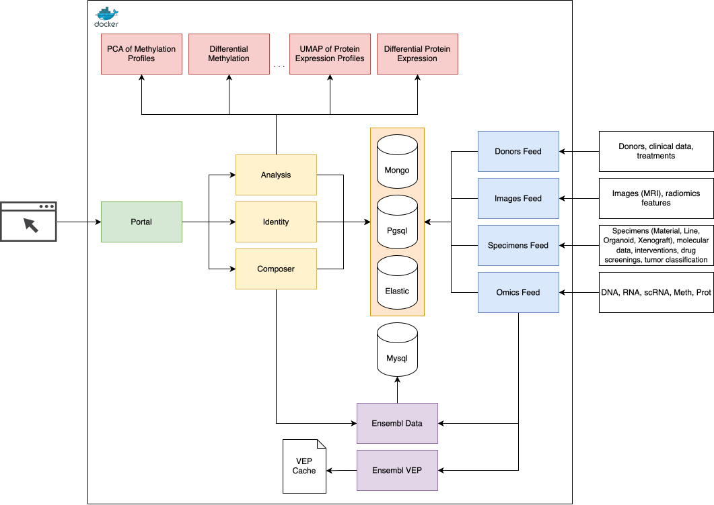

# Architecture
The platform consists of multiple components communicating over REST APIs.
The overview below was updated from owner explanations and selected code paths
during onboarding on 2026-10-06. Detailed operational behavior and the existing
diagram have not yet been fully revalidated.

### Environment
[Docker](https://www.docker.com/) is used to deploy the platform. Each component is a separate docker container. To locate each other, containers share a common docker network.

`unite-env` contains infrastructure under `programs/` and platform applications
under `applications/`. Run scripts through `sh` from their containing directory:
`scripts/deploy.sh` deploys the whole platform; component `deploy.sh`,
`build.remote.sh [branch]`, and `build.local.sh` select published images, remote
source, or local source respectively. Ensembl database/cache setup is separate.
The owner manages servers through SSH with portal access on 80/443 and no
direct external database access. Shared `.env` configuration is being introduced
in Identity; extending it and simplifying Compose inheritance are planned.
See [Deployment and development](../docs/deployment-and-development.md).

### Infrastructural Components
- [Postgresql](https://www.postgresql.org/) - domain and identity data storage
- [MySQL](https://www.mysql.com/) - local Ensembl data storage on legacy MySQL; only required database parts/tables are populated (`unite-env` currently configures MySQL 5.6)
- [MongoDB](https://www.mongodb.com/) - submission/cache storage, saved dataset presets (`user-data.datasets`), and analysis records (`user-data.analyses`)
- [Elasticsearch](https://www.elastic.co/) - data index storage and search engine

### Application Components
- [Data Source](https://github.com/dkfz-unite/unite-data-source) - discovers configured files through sample sheets or custom crawlers, submits data/metadata to feeds, and serves source files for later analysis
- [Ensembl Data](https://github.com/dkfz-unite/unite-ensembl-data) - custom web wrapper around the local Ensembl database for gene/transcript/protein enrichment
- [Ensembl VEP](https://github.com/dkfz-unite/unite-ensembl-vep) - custom web wrapper around Ensembl Variant Effect Predictor using local reference cache files
- [Donors Feed](https://github.com/dkfz-unite/unite-feed-donors) - donors data submission API and indexing service
- [Images Feed](https://github.com/dkfz-unite/unite-feed-images) - images data submission API and indexing service
- [Specimens Feed](https://github.com/dkfz-unite/unite-feed-specimens) - specimens data submission API and indexing service
- [Omics Feed](https://github.com/dkfz-unite/unite-feed-omics) - omics data submission API and indexing service
- [Identity](https://github.com/dkfz-unite/unite-identity) - authentication, account/session management, signed user/service JWTs, and account saved-data cleanup
- [Composer](https://github.com/dkfz-unite/unite-composer) - data access, search, and administrator submission-review API
- [Analysis](https://github.com/dkfz-unite/unite-analysis) - analysis API, Prepare/Process orchestration, result access, and Scell viewer orchestration
- [Commands](https://github.com/dkfz-unite/unite-commands) - web wrapper for configured scientific commands, usually embedded in analysis runner containers, with a configurable process limit
- [Portal](https://github.com/dkfz-unite/unite) - Vue web interface in `Unite.Web/Client`, hosted by an ASP.NET server with service reverse proxying

### Ingestion and integration

Data enters through the portal UI or feed APIs. `unite-data-source` automates
discovery and API submission and provides access to externally stored files.

- **Tight/deep integration** stores structured domain data whose values can be
  indexed and filtered.
- **Loose integration** stores metadata, availability, and resource URLs. File
  contents remain at the source and are downloaded when required for analysis;
  their values do not participate in integrated search filters.

The standard review path validates input, stages the accepted submission in
MongoDB, and creates a SQL submission task. Administrator approval makes it
ready for workers to integrate data and initiate further processing/indexing.
Rejection stops integration. Task creation, approval, domain writing, and
indexing are separate stages.

See [Data ingestion and review](../docs/data-ingestion.md) for details and the
currently unused `review=false` option intended for possible future trusted
automated services.

### Worker processing

- Donor, image, and specimen submission workers write SQL domain data and
  create indexing tasks.
- New variants are written without transcript consequences, then annotation
  workers obtain consequences through the VEP wrapper and write them to SQL
  before scheduling indexing.
- Gene/protein expression is enriched through Ensembl Data during submission
  processing, then indexed; it does not use the separate VEP task stage.
- Indexing workers read SQL, build documents, and write them into Elasticsearch.
  Successful indexing tasks are removed.

Task states have type-specific meanings; completed tasks may be deleted rather
than retained as `Processed`. Internal submission-processing errors trigger
another attempt. Administrator rejection is stored as `Rejected` with a reason
in `Comment`; rejected submissions are retained and cleanup is not implemented.

Variants without transcript consequences are still indexed. Fully neutral CNV
without LOH remain in SQL but are excluded from indexing, so indexes do not
contain every SQL record. See [Processing pipeline](../docs/processing-pipeline.md).
Index document models are defined in
[unite-indices](https://github.com/dkfz-unite/unite-indices).

### Search and data access

`unite-indices` is a library repository with document models, Elasticsearch
context services, and the search engine. Composer provides the HTTP data API.
Related data lives in separate collections connected by compact navigation
objects. Cross-reference search filters related collections, aggregates linked
IDs, and constrains the target collection; it does not embed every associated
record in a single donor document.

Composer constructs `PersonalSearchCriteria` from authenticated user claims.
Accessible projects constrain the search scope, which must also govern analysis
data selection. Combined specimen/mutation criteria match the same specimen.
See [Search and access](../docs/search-and-access.md) for the design, selected
implementation paths, and remaining private-project verification.

### Saved datasets

Users save search criteria as named dataset presets with descriptions in
MongoDB `user-data.datasets`, through Composer. The portal's datasets page
shows criteria, matching data amounts, and available modalities; analysis
controls use modality availability and method-specific requirements. Matching
membership is evaluated through search rather than stored as a separate frozen
list. See [Datasets and portal](../docs/datasets-and-portal.md).

### Analysis pipeline and viewers

The portal sends selected dataset criteria and method options to Analysis,
which creates a Mongo record and SQL analysis task. Prepare resolves matching
data/samples through search and SQL/resources, formats inputs in a shared
Docker volume, and sets `Prepared`. Process invokes a method-specific runner or
internal computation, processes outputs, archives results, and sets `Processed`.

Busy command runners refuse requests at their process limit; Analysis retries
eligible tasks. Preparation/computation failure is `Failed` and requires manual
restart. Analyses and their remaining files persist until user deletion. File
contracts and temporary-input cleanup vary by method.

Ordinary results are visualized in the browser from result data. Scell produces
AnnData/H5AD and uses a local Cell-x-Gene fork: an on-demand viewer container
per dataset, reached through `/viewer/cxg<number>/` proxy routes and a portal
iframe. Idle viewer removal does not delete analysis results. See
[Analysis pipeline](../docs/analysis-pipeline.md).

### Identity and account lifecycle

`UNITE_INSTANCE_PUBLIC` controls registration access: public instances allow
registration without an access list, private instances require an email added
by an administrator. This differs from project visibility. Identity issues
JWTs signed with `UNITE_API_KEY`; services validate signatures/lifetimes and
apply actor/role/permission policies. Active data permissions are `Data.Read`
and `Data.Write`, with a configured root administrator.

Admin-issued worker tokens currently serve `unite-data-source`. Their scope for
private projects is not yet defined. Identity removes expired sessions and
inactive accounts and deletes saved datasets/analyses with accounts. Complete
analysis-directory cleanup remains to be checked across deletion paths. See
[Identity and lifecycle](../docs/identity-and-lifecycle.md).

### Diagram
The existing diagram shows the platform components. Its coverage of data-source
hosting and review stages has not yet been checked against the description above.

