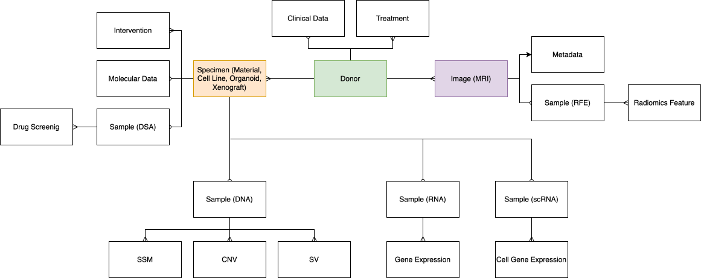

# Data Structure
UNITE integrates biomedical modalities around a central donor entity.

The core rules below were confirmed by the project owner during onboarding on
2026-10-06. See the [domain model](../docs/domain.md) for rationale, selected code
references, and questions still being resolved.

The main source of domain entity and data-type definitions is
[unite-data](https://github.com/dkfz-unite/unite-data), particularly
`Unite.Data/Entities` and `Unite.Data.Context/Mappers`.

## Core relationships

- A donor represents anonymized patient data. Donor-associated biomedical data
  cannot exist independently of a donor.
- A donor can belong to zero or more projects. Projects provide grouping and
  statistical context.
- A donor can have multiple images and biological specimens. Images are linked
  to the donor, not directly to a specimen, because a reliable association with
  a particular primary, recurrent, or metastatic tumor cannot be assumed.
- Specimens can form a derivation hierarchy: donor-derived material may give
  rise to a cell line (`Line`), organoid, xenograft, or further derived specimens.
- A biological specimen is distinct from its digital omics samples. Each
  specimen can provide data from different assay types.

## Sample and result constraints

Each specimen has at most one sample of a given modality. WGS and WES are
primary-assay subtypes of the same DNASeq slot; separate WGS and WES samples on
one specimen are not supported by the intended domain model.

In current code, `Sample.AnalysisId` is required and identifies primary assay
metadata, not a variant-calling run or dataset analysis. Renaming this concept
to Primary Assay is planned.

Each specimen has one active result set per result kind, independent of assay
origin. For example, CNVProfiles can come from WGS or MethArray, but there is
one shared set for the specimen. A set may contain many entries. Repeated
uploads merge or replace data instead of exposing parallel result runs. This
is an intentional simplification.

The merge/replace behavior and the implementation enforcement points remain
to be documented; see [domain model](../docs/domain.md).

## Project visibility

Private projects are under development. The intended rule restricts associated
data to users added to the project; data in public projects is visible to any
platform user. Donors submitted without a project are assigned to the default
public project `Other`. Membership in any public project makes a
donor's data visible even if it also belongs to a private project. The case of
several private projects remains to be clarified.

## Data Types
The documented data groups are listed below. This page is not a complete audit
of current support for every assay or image type.
- Donors
  - [General](https://github.com/dkfz-unite/unite-feed-donors/blob/main/Docs/api-models-donors.md) - anonymized donor information
  - [Clinical](https://github.com/dkfz-unite/unite-feed-donors/blob/main/Docs/api-models-base-clinical.md) - patient clinical data
  - [Treatments](https://github.com/dkfz-unite/unite-feed-donors/blob/main/Docs/api-models-base-treatment.md) - patient treatments
- Images
  - [General](https://github.com/dkfz-unite/unite-feed-images/blob/main/Docs/api-models-image.md) - metadata of different types of images
    - [MRI](https://github.com/dkfz-unite/unite-feed-images/blob/main/Docs/api-models-mrs.md)
  - Radiomics features extraction analysis (RFE) data
    - [Sample](https://github.com/dkfz-unite/unite-feed-images/blob/main/Docs/api-models-base-sample.md) metadata
    - [Radiomics features](https://github.com/dkfz-unite/unite-feed-images/blob/main/Docs/api-models-radiomics.md)
- Specimens
  - [General](https://github.com/dkfz-unite/unite-feed-specimens/blob/main/Docs/api-models-specimen.md) - general information of specimens and their hierarchy
    - [Material](https://github.com/dkfz-unite/unite-feed-specimens/blob/main/Docs/api-models-material.md) - all donor derived materials
    - [Line](https://github.com/dkfz-unite/unite-feed-specimens/blob/main/Docs/api-models-line.md) - cell lines
    - [Organoid](https://github.com/dkfz-unite/unite-feed-specimens/blob/main/Docs/api-models-organoid.md) - organoids
    - [Xenograft](https://github.com/dkfz-unite/unite-feed-specimens/blob/main/Docs/api-models-xenograft.md) - xenografts
  - [Molecular](https://github.com/dkfz-unite/unite-feed-specimens/blob/main/Docs/api-models-base-molecular.md) - specimens molecular data
  - [Interventions](https://github.com/dkfz-unite/unite-feed-specimens/blob/main/Docs/api-models-base-intervention.md) - specimen interventions
  - Drugs screening analysis (DSA) data
    - [Sample](https://github.com/dkfz-unite/unite-feed-specimens/blob/main/Docs/api-models-base-sample.md) metadata
    - [Drug screenings](https://github.com/dkfz-unite/unite-feed-specimens/blob/main/Docs/api-models-drugs.md)
- Omics
  - DNA analysis data
    - [Sample metadata](https://github.com/dkfz-unite/unite-feed-omics/blob/main/Docs/models-dna.md), including an optional matched sample
    - Variants of different types
      - [Simple mutations (SM)](https://github.com/dkfz-unite/unite-feed-omics/blob/main/Docs/models-dna-sm.md) - SNV/INDEL; the category is not restricted to somatic mutations
      - [Copy number variants (CNV)](https://github.com/dkfz-unite/unite-feed-omics/blob/main/Docs/models-dna-cnv.md)
      - [Structural variants (SV)](https://github.com/dkfz-unite/unite-feed-omics/blob/main/Docs/models-dna-sv.md)
  - Bulk RNA analysis data
    - [Sample metadata](https://github.com/dkfz-unite/unite-feed-omics/blob/main/Docs/models-rna.md)
    - [Gene expressions](https://github.com/dkfz-unite/unite-feed-omics/blob/main/Docs/models-rna-exp.md)
  - Single cell RNA analysis data
    - [Sample metadata](https://github.com/dkfz-unite/unite-feed-omics/blob/main/Docs/models-rnasc.md)
    - [Gene expressions per cell](https://github.com/dkfz-unite/unite-feed-omics/blob/main/Docs/models-rnasc-exp.md) - results metadata

  - Methylation array data
    - [Sample and assay metadata](https://github.com/dkfz-unite/unite-feed-omics/blob/main/Docs/models-meth.md)
  - Proteomics data
    - Protein expression/abundance; see the [domain model](../docs/domain.md)

RNA gene fusions are planned and are not listed as currently available data.

### Diagram
The existing diagram is reference material; its terminology and cardinalities
have not yet been reviewed against the updated rules above. A current conceptual
diagram is available in the [domain model](../docs/domain.md).

## API
Data can be submitted through the portal UI for simpler, smaller data or through
the following APIs. `unite-data-source` automates file discovery, submission,
and resource hosting. Accepted submissions enter the standard data-review
workflow before domain integration; see [Data ingestion](../docs/data-ingestion.md).

- [Donors Feed](https://github.com/dkfz-unite/unite-feed-donors/blob/main/Docs/api.md) - all donor-related data
- [Images Feed](https://github.com/dkfz-unite/unite-feed-images/blob/main/Docs/api.md) - all images related data
- [Specimens Feed](https://github.com/dkfz-unite/unite-feed-specimens/blob/main/Docs/api.md) - all specimens related data
- [Omics Feed](https://github.com/dkfz-unite/unite-feed-omics/blob/main/Docs/api.md) - omics data
